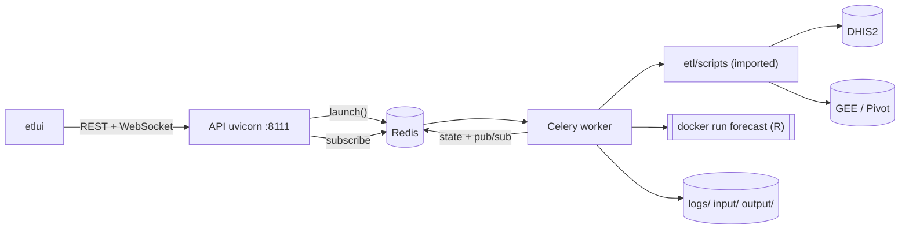

# `etlhub` architecture (Hub Center API)

> Compact version, updated on 2026-10-02 from a reading of the code; the statements listed in `known-issues.md` §6 (audit 2026-11-27) corrected on 2026-11-27. Nothing was run under real conditions: the behaviours described here are read from the code, not observed.
> Endpoint and variable tables: `.claude/skills/etlhub/references/reference.md`. Known problems: `known-issues.md`.

## 1. Role

A **FastAPI** service that exposes the PRIDE-C ETL scripts (`etl/scripts/*.py`) and the R forecast pipeline over HTTP. Long-running tasks run in **Celery** workers; state and logs live in **Redis** and in `logs/`; progress is broadcast over **WebSocket**. The front-end is `etlui` (Vue).

## 2. Runtime topology

| Process | How to start it | Note |
|---|---|---|
| API | `cd etlhub && python -m run_server` | `main.py` does `os.chdir` to the repository root |
| Worker | `python -m etlhub.run_celery` (from the root) | default prefork pool; its working directory is where it starts: the repo root (`/opt/pridec` in `deploy/compose.yaml`) |
| Redis | `redis-server` | external, `localhost:6379/0` by default |

The root `compose.yaml` is the CLI's (`etl`, `forecast`), and `README.md` mentions a `compose-prod.yaml` that is not in the repository.

## 3. Layers

| Layer | Content |
|---|---|
| `core/` | `config.py`, `dependencies.py` (composition root), `celery_app.py` |
| `domain/` | exceptions, `Protocol` ports, Pydantic DTOs |
| `application/use_cases/` | services (generate the `job_id`), `ETL_JOBS` table, stdout capture, webhook |
| `infrastructure/` | `tasks.py`, `job_store.py`, `request_tracker.py`, `config_store.py`, `auth_store.py`, `forecast_runner.py`, `checkpoint_store.py`, `default_files.py`, `etl_events.py` |
| `api/` | routers, WebSocket, DHIS2 auth, middleware |

Intended direction: `api` → `application`, `core` · `application` → `domain` · `infrastructure` → `domain`, `application` · `domain` → nothing. Adapters are singletons (`@lru_cache`); services are built per request (`Depends`).

Actual deviations: none between etlhub layers since 2026-10-23 (`tests/test_architecture.py`). Services and `api` depend on the ports of `domain/interfaces/`, bound in `core/dependencies.py`; inside `infrastructure`, `tasks.py` still builds `JobStore()` and calls `get_checkpoint_store()` directly. Outside etlhub, the coupling with the rest of the repository relies on `sys.path` and on `os.chdir` (`main.py`): `etlhub` imports `etl.scripts.*` (`etl/scripts/config.py` no longer imports etlhub since 2026-10-22).

Outside the written rule but widespread: `api` → `domain` (DTOs), `infrastructure` and `application` → `core` (configuration), `core/dependencies.py` as composition root, `application` → `etl.scripts` (wrappers). The team must say whether they are tolerated. The domain imports only `typing` and `pydantic`. Measurements and method rules: `DEVELOPMENT.md`.

## 4. Job lifecycle

1. `POST /<job>?webhook_url=…` → the service generates `job_id = <type>_<8 hex>` and calls `CeleryTaskLauncher.launch` → **202** response `{status, message, job_id, webhook_url}`.
2. The worker runs `task_etl` (or `task_forecast`) → `_run_task`: `job:{id}` becomes `running`, the script runs with stdout/stderr captured (`_JobLogger`), each fragment is appended to the job log (`JobStore.append_logs`: Redis `etl_logs:{id}` and `logs/{id}.log`, written once) then published on `etl_logs:{id}`.
3. End: `job:{id}` becomes `success` or `error`, a message is published on `etl_status:{id}`, and the webhook is POSTed if one was given. On error the task re-raises the exception.
4. The front opens `WS /api/tracking/etl-logs/{job_id}`: `etl_log_history` → `job_status_update` / `etl_log_entry` → `etl_log_complete` → close. Subscribes before reading history and status, waits for pub/sub messages with a 1 s timeout (no busy-wait), re-reads `job:{id}` every 10 s in case the final event was missed, and stops when the client leaves. Closes with `4004` **only for an unknown job** (no `job:{id}` and no logs); a known job without logs yet gets an empty `etl_log_history` and stays open. A job whose record expired but has logs gets its history then `etl_log_complete` with `final_status: null`. Jobs are recorded as `pending` at launch (`CeleryTaskLauncher.launch`), so they are known from the 202 on.

Worth knowing:
- Forecast logs are appended line by line as `docker run` prints them (since 2026-10-21).
- `etlui` shows the step states of `GET /pipeline/checkpoints` and follows a launched job to its end (`usePipeline.ts`): a 202 is not a success.
- No timeout on jobs (Celery, forecast `subprocess.Popen`, calls of the `etl/` scripts), by decision (2026-11-17): durations are never static, a forecast can exceed 10 minutes. If the worker is killed, `job:{id}` stays `running` until its TTL (30 days) expires, and the WebSocket stays open.
- Every job follows this model: `/post_forecast` since 2026-11-24, `/update_key` and the imports approval since 2026-11-27 (Celery, 202; they ran synchronously in the API before).

## 5. State and persistence

| Data | Where | Lifetime |
|---|---|---|
| Job status | Redis `job:{id}` | 30-day TTL |
| Job logs | Redis `etl_logs:{id}` + `logs/{id}.log`, `logs/{id}.json` (forecast) | 30-day TTL; files are never purged |
| HTTP requests | SQLite `logs/etlhub.db`, table `request_log` | 30 days, purged on each insert. Unhandled errors recorded as 500 with `error`; `/api/tracking` never recorded |
| Dynamic config | Redis, hash `app:config:dynamic` | no TTL; `config_store.EDITABLE_KEYS` overwritten from `.env` at each API start (lifespan) and by `PUT /api/config/reload` |
| ETL data | `input/`, `output/` | never purged |
| Default input files | Files of `assets/`, read on each request, no table (`docs/decision-design/default-input-files/default-input-files.md`); etlhub must reach `assets/` in production too | not stored |

`list_recent` reads the `request_log` table of `logs/etlhub.db`, newest first, not Redis. Scripts write under `os.getcwd()/input|output`, the repository root for the API and the worker; in test mode etlhub moves what they fetched to `test/input` (`core/job_context.work_dir`). Redis has four roles: Celery broker and backend, job state, pub/sub, and dynamic configuration. The dynamic config (`config_store.EDITABLE_KEYS`: `PARENT_OU`, `OU_LEVEL`, `DISEASE_CODE`, `LOG_LEVEL`, `PIVOT_URL`) is read by the ETL scripts only (`etlhub/script_config.py`); `DRYRUN` is the mode served (DRYRUN = TEST MODE), the DHIS2 URL and token come from the login, and the forecast container gets no env.

## 6. External integrations

- **DHIS2**: writes (`dataValueSets`, `resourceTables`, datastore) and reads (`analytics`, `organisationUnits`). The scripts use the configuration from `etl/scripts/config.py`.
- **GEE** and **Pivot**: read by `import_gee` and `import_pivot_*` (service key `.gee-private-key.json` in the current directory).
- **Docker**: the worker runs `mvevans89/pridec_forecast:1.1.0`, pinned by digest (`--network none`, no env, `--cap-drop ALL --cap-add SYS_NICE`, `input/` read-only, `output/` read-write); it needs access to the Docker socket.
- **Authentication** (`api/auth/`, `infrastructure/auth_store.py`): `etlui` sends a DHIS2 URL, username and password to `POST /auth/login`. etlhub checks them (`GET /api/me`, Basic auth). Since 2026-11-26 there is **one personal access token per account**, 30 days (`TOKEN_LIFETIME_SECONDS`), in Redis `dhis2:credential:{username}` with that TTL, plus `created_at` and the hash of the browser that created it. The browser gets two cookies (`HttpOnly`, `SameSite=Strict`, `Secure` unless `COOKIE_SECURE=false`): `etlhub_session`, 24 h (`SESSION_LIFETIME_SECONDS`, Redis `session:{sha256(id)}`), and `etlhub_device`, 30 days, a random browser id (never the token). A login from the browser that created the account's token **reuses it** while DHIS2 accepts it; otherwise (another browser, another DHIS2, a token revoked in DHIS2) etlhub revokes that account's token (not while a job holds the pipeline lock: a job read a token at its start), creates a new one (`POST /api/apiToken`, `MethodAllowedList` attribute required by DHIS2 2.40) and checks it. `get_current_user` accepts a session only while its `pat_uid` is its account's token, so a login from another browser logs the first one out; other accounts are never affected. `POST /auth/logout` revokes its account's token with the token itself (checked against DHIS2 2.40.3 on 2026-10-08; not while a job runs) and forgets it. The ETL jobs use the **most recently created** token of all accounts (`auth_store.get_credential()` without a username). The password is never stored or logged; the token never reaches the browser (`GET /api/config/` returns `has_dhis_token`). Safeguards: `DHIS2_ALLOWED_HOSTS` (empty = every login refused, https required except localhost, no redirects followed), 5 failed logins per IP and username in 15 min → 429, and `check_origin` (`api/middleware.py`) refuses POST/PUT/PATCH/DELETE whose `Origin` is not `FRONTEND_URL`. The ETL scripts read the credential through `get_dhis_url()` / `get_dhis_token()` (`etl/scripts/config.py`). On its own that module is the CLI version (environment / `.env` only, no `etlhub`, no Redis); `etlhub/script_config.py`, imported by `etlhub/__init__.py`, replaces its `_get` / `_dhis2_credential` in every etlhub process: editable keys from Redis (a Redis error fails the job), credential from the login. Without a login they raise `DHIS2SessionError` ("log in again") instead of using `.env`, unless `DHIS_ENV_FALLBACK=true` is in the etlhub process environment (debug only). The forecast container never receives `DHIS_URL` / `DHIS_TOKEN`. Persistence relies on Redis AOF (`redis.conf`). Every router except `auth_router` requires the session through `include_router(..., dependencies=[Depends(get_current_user)])`; `get_current_user` takes an `HTTPConnection`, so it also guards the log WebSocket: wrong `Origin` → handshake refused (403), no session → accepted then closed with `4401`. `tests/api/test_route_protection.py` walks every route.

## 7. Data pipeline

The workflow follows the reference documentation (`pivot_forecast.sh`, 3 phases); `etlui` does not automate it: one step per click, and the pipeline gate enforces the order (see Concurrency below and `docs/decision-design/pipeline-checkpoints/pipeline-checkpoints.md`).
① imports → `approve_imports` (decision per Pivot data element, `POST /pipeline/imports/approve`: its Celery job posts the chosen elements to DHIS2) → `build_analytics`; ② 9 runs (`config/<disease>` + `external_data/<level>` uploads, `fetch_*` → `validate_inputs` → `forecast` → `calc_orgunit_alerts` (CSB runs, Celery job since 2026-11-24) → `approve` → `post_forecast`); ③ `build_analytics` → `update_key`. `calc_csb_alerts` is no longer exposed (its script stays in `etl/scripts/`).

| Step | Reads | Writes | Depends on |
|---|---|---|---|
| `import_gee` | GEE (last 3 months) | DHIS2 `dataValueSets` | — |
| `import_pivot_com`, `import_pivot_csb` | Pivot (8 months; COM under the pass's `PARENT_OU`) | Redis `pivot_fetched:<mode>:<pass>:<task>`: the library's items (values and check), replaced whole by the next fetch of that import in the pass, kept across logouts and forecast runs (since 2026-11-23; files in `input/temp_fetch` before, emptied by a run's opening); **nothing to DHIS2** (since 2026-11-20, `fetch_pivot.py`, `infrastructure/fetched_imports.py`) | — |
| `approve_imports` | the fetched values of the elements chosen (Redis, the pass's) | DHIS2 `dataValueSets` (DRYRUN = TEST MODE) | import_pivot_com, import_pivot_csb |
| `build_analytics` | — | DHIS2 `resourceTables/analytics` (`application/use_cases/build_analytics.py`, etlhub's copy of the script and of `pivot_dhis_tools.launch_analytics` without its 15-minute limit since 2026-11-23: waits for DHIS2's end however long, checking every 30 s, each new message of its DHIS2 notification once in the job's log (DHIS2 updates one notification in place); a network cut or a 5xx while checking is waited out, a 4xx fails it; the CLI keeps the limit; nothing in dry run, i.e. in test mode; a success invalidates the stored import availability checks) | the imports |
| `fetch_climate` | DHIS2 `analytics` | `input/climate_data.json` | import_gee, build_analytics |
| `fetch_disease` | DHIS2 `analytics` (`DISEASE_CODE`) | `input/disease_data.json` | import_pivot_*, build_analytics |
| `fetch_geojson` | DHIS2 `organisationUnits.geojson` | `input/orgUnit_poly.geojson` | — |
| `validate_inputs` | `input/` + user-provided `config.json` (`forecast_start` written by the server) and `external_data.csv` | `input/{config,input,polygon}_valid.*` | the 3 `fetch_*` |
| `forecast` | the 3 `*_valid` files | `output/` (`forecast_report.html`, `forecast.json`), `logs/{id}.json` | validate_inputs |
| `post_forecast` | `output/forecast.json` | DHIS2 `dataValueSets` | forecast |
| `calc_orgunit_alerts` | `ALERT_NAME` | alert thresholds | forecast (CSB runs; Celery job since 2026-11-24, `application/use_cases/calc_alerts.py`, etlhub's copy of `calc_orgUnit_alerts.py`; writes `output/alerts.json`, posted by `post_forecast`) |
| `update_key` | — | DHIS2 datastore `pridec/pridec_update` | last |

Concurrency: **one job at a time**, in cycle order, **one forecast run (source × disease) at a time** (`domain/pipeline.py`, `infrastructure/checkpoint_store.py`, tables `checkpoints`, `pipeline_lock`, `forecast_runs` in `logs/etlhub.db`). Every change also appends to `pipeline_events` in the same transaction: the journal of a pass, one run of a cycle (`GET /pipeline/passes/{pass_id}/journal`, `docs/decision-design/cycle-passes/`), with the actor and the `request_id` that `core/request_context.py` carries from the middleware and `get_current_user` (`docs/decision-design/cycle-journal/`). A launch while a job runs, before its prerequisites are in `success`, or a run job without an open run, gets 409. The lock is taken at launch and freed by `_update_task_status` (success/error); it never expires: `DELETE /pipeline/lock` frees it. Opening a run empties `input/` and `output/`; each run job gets the run's `DISEASE_CODE` / `OU_LEVEL` written into the dynamic config before it starts. No deduplication: imports resend the same values on every run, so deduplication depends on DHIS2. See `docs/decision-design/pipeline-checkpoints/pipeline-checkpoints.md`.

## 8. Security (summary)

1. Every route needs the etlui session except `/auth/login`, `/auth/logout`, `/auth/dhis2-urls`, `GET /` and FastAPI's `/docs`, `/redoc`, `/openapi.json`. There are no roles (removed 2026-11-17, with the admin check of `DELETE /pipeline/lock` and the journal CSV): any logged-in user can call any route.
2. There is no endpoint deleting `output/` (`DELETE /output/reset` removed 2026-10-23): opening a run empties it. Forecast containers run as the worker's user (`--user uid:gid`), so their files are not root-owned.
3. `webhook_url` must be https to a host of `WEBHOOK_ALLOWED_HOSTS` (empty = every webhook refused; `WebhookUrl`, `api/routers/__init__.py`). The login only sends credentials to `DHIS2_ALLOWED_HOSTS`.
4. The middleware logs the URL in `logs/etlhub.db` with the value of `webhook_url` masked (`_logged_url`); any other secret in a query string would still be stored. The login password travels in the body and is not logged.
5. The worker needs the Docker socket (equivalent to root on the host).

## 9. Operations

- **Start**: see section 2, plus `GETTING_STARTED.md`. The real port is 8111 (`.vscode/launch.json` still says 8000).
- **Test**: `cd etlhub && ../test-venv/bin/python -m pytest tests -m "not integration"`. 401 tests on 2026-11-27 (line coverage 93 % at the audit of that day ; `known-issues.md` §6), Redis and GEE mocked; request logs go to SQLite in `tmp_path`, nothing into `logs/`. `etlhub/pytest.ini` sets `pythonpath = .` and the `integration` marker.
- **CI**: `etlhub-unit-tests.yml` (push and PR on `etlhub/**`), `etlhub-integration-tests.yml` (PR, DHIS2 secrets).
- **Observe**: `GET /api/tracking/*`, `logs/`. There is no logging configuration in `etlhub/`.
- **Purge**: `request_log` keeps 30 days (except the requests a production journal refers to); nothing else is automatic (`logs/`, `input/`, `output/`). `logs/requests/` only holds leftovers of older test runs (`known-issues.md` §5). `dump.rdb` and `logs/` are ignored by git.
