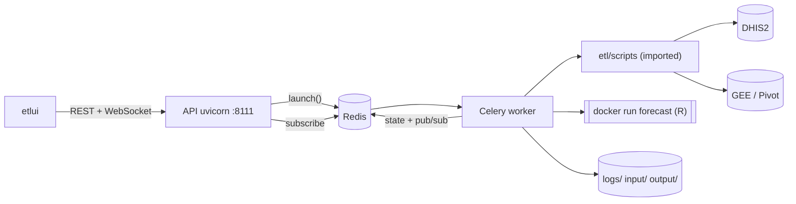

# `etlhub` architecture (Hub Center API)

> Compact version, updated on 2026-10-02 from a reading of the code. Nothing was run under real conditions: the behaviours described here are read from the code, not observed.
> Endpoint and variable tables: `.claude/skills/etlhub/references/reference.md`. Known problems: `known-issues.md`.

## 1. Role

A **FastAPI** service that exposes the PRIDE-C ETL scripts (`etl/scripts/*.py`) and the R forecast pipeline over HTTP. Long-running tasks run in **Celery** workers; state and logs live in **Redis** and in `logs/`; progress is broadcast over **WebSocket**. The front-end is `etlui` (Vue).

## 2. Runtime topology

| Process | How to start it | Note |
|---|---|---|
| API | `cd etlhub && python -m run_server` | `main.py` does `os.chdir` to the repository root |
| Worker | `python -m etlhub.run_celery` (from the root) | default prefork pool, working directory not verified |
| Redis | `redis-server` | external, `localhost:6379/0` by default |

Deployment outside a development machine is **not documented**: no etlhub Dockerfile, neither etlhub nor Redis in `compose.yaml`, and `README.md` mentions a `compose-prod.yaml` that is not in the repository.

## 3. Layers

| Layer | Content |
|---|---|
| `core/` | `config.py`, `dependencies.py` (composition root), `celery_app.py` |
| `domain/` | exceptions, `Protocol` ports, Pydantic DTOs |
| `application/use_cases/` | services (generate the `job_id`), `ETL_JOBS` table, stdout capture, webhook |
| `infrastructure/` | `tasks.py`, `job_store.py`, `request_tracker.py`, `config_store.py`, `forecast_runner.py`, `checkpoint_store.py`, `default_files.py` |
| `api/` | routers, WebSocket, DHIS2 auth, middleware, `etl_events.py` |

Intended direction: `api` → `application`, `core` · `application` → `domain` · `infrastructure` → `domain`, `application` · `domain` → nothing. Adapters are singletons (`@lru_cache`); services are built per request (`Depends`).

Actual deviations: `application` and `infrastructure` import `etlhub.api.etl_events` (no event port); `api` uses `ConfigStore` and `get_request_tracker` without injection; `api` calls `etl.scripts` (`get_dhis_url`). Above all, the coupling with the rest of the repository is **circular**: `etlhub` imports `etl.scripts.*`, and `etl/scripts/config.py` imports `etlhub.infrastructure.config_store`. This relies on `sys.path` and on `os.chdir` (`main.py`).

Outside the written rule but widespread: `api` → `domain` (DTOs), `infrastructure` and `application` → `core` (configuration), `core/dependencies.py` as composition root, `application` → `etl.scripts` (wrappers). The team must say whether they are tolerated. The domain imports only `typing` and `pydantic`. Measurements and method rules: `DEVELOPMENT.md`.

## 4. Job lifecycle

1. `POST /<job>?webhook_url=…` → the service generates `job_id = <type>_<8 hex>` and calls `TaskLauncher.launch` → **202** response `{status, message, job_id, webhook_url}`.
2. The worker runs `task_etl` (or `task_forecast`) → `_run_task`: `job:{id}` becomes `running`, the script runs with stdout/stderr captured (`_JobLogger`), each fragment is published on `etl_logs:{id}` and appended to `logs/{id}.log`.
3. End: `job:{id}` becomes `success` or `error`, a message is published on `etl_status:{id}`, and the webhook is POSTed if one was given. On error the task re-raises the exception.
4. The front opens `WS /api/tracking/etl-logs/{job_id}`: `etl_log_history` → `job_status_update` / `etl_log_entry` → `etl_log_complete` → close. Subscribes before reading history and status, waits for pub/sub messages with a 1 s timeout (no busy-wait), re-reads `job:{id}` every 10 s in case the final event was missed, and stops when the client leaves. Closes with `4004` **only for an unknown job** (no `job:{id}` and no logs); a known job without logs yet gets an empty `etl_log_history` and stays open. A job whose record expired but has logs gets its history then `etl_log_complete` with `final_status: null`. Jobs are recorded as `pending` at launch (`CeleryTaskLauncher.launch`), so they are known from the 202 on.

Worth knowing:
- Forecast writes its logs **only at the end**: a WebSocket opened during the run gets status updates but no log lines until the end.
- `etlui` marks a step `success` as soon as it receives the 202, without waiting for the job to finish.
- No timeout anywhere (Celery, forecast `subprocess.run`). If the worker is killed, `job:{id}` stays `running` until the TTL (24 h) expires, and the WebSocket stays open.
- `/post_forecast` and `/update_key` do not follow this model: they run **synchronously** in the API, which blocks the asyncio loop.

## 5. State and persistence

| Data | Where | Lifetime |
|---|---|---|
| Job status | Redis `job:{id}` | 24 h TTL |
| Job logs | Redis `etl_logs:{id}` + `logs/{id}.log`, `logs/{id}.json` (forecast) | 24 h TTL; files are never purged |
| HTTP requests | SQLite `logs/etlhub.db`, table `request_log` | 30 days, purged on each insert. Unhandled errors recorded as 500 with `error`; `/api/tracking` never recorded |
| Dynamic config | Redis, hash `app:config:dynamic` | no TTL |
| ETL data | `input/`, `output/` | never purged |
| Default input files | Files of `assets/`, read on each request, no table (`docs/decision-design/default-input-files/default-input-files.md`); etlhub must reach `assets/` in production too | not stored |

`list_recent` reads the files in `logs/requests/` (sorted by modification time), not Redis. Scripts write under `os.getcwd()/input|output`: the repository root on the API side, and an unverified directory on the worker side. Redis has four roles: Celery broker and backend, job state, pub/sub, and dynamic configuration. The dynamic config (`DHIS_URL`, `DHIS_TOKEN`, `PARENT_OU`, `OU_LEVEL`, `DISEASE_CODE`) is read by the forecast container **and** by the ETL scripts (which also read `DRYRUN` and `LOG_LEVEL`).

## 6. External integrations

- **DHIS2**: writes (`dataValueSets`, `resourceTables`, datastore) and reads (`analytics`, `organisationUnits`). The scripts use the configuration from `etl/scripts/config.py`.
- **GEE** and **Pivot**: read by `import_gee` and `import_pivot_*` (service key `.gee-private-key.json` in the current directory).
- **Docker**: the worker runs `mvevans89/pridec_forecast:0.1.0` (`host` network, `input/` read-only, `output/` read-write); it needs access to the Docker socket.
- **Authentication** (`api/auth/`, `infrastructure/auth_store.py`): `etlui` sends a DHIS2 URL, username and password to `POST /auth/login`. etlhub checks them (`GET /api/me`, Basic auth), revokes the token it created at the previous login, creates a 24 h personal access token (`POST /api/apiToken`, `MethodAllowedList` attribute required by DHIS2 2.40), checks it, and stores it in Redis `dhis2:credential` with a 24 h TTL. The browser gets an `etlhub_session` cookie (`HttpOnly`, `SameSite=Strict`, `Secure` unless `COOKIE_SECURE=false`); Redis keeps `session:{sha256(id)}` with the same TTL. `get_current_user` accepts a session only while its `pat_uid` is the active credential's, so a new login logs every other session out. `POST /auth/logout` revokes the token with the token itself (checked against DHIS2 2.40.3 on 2026-10-08) and deletes it. The password is never stored or logged; the token never reaches the browser (`GET /api/config/` returns `has_dhis_token`). Safeguards: `DHIS2_ALLOWED_HOSTS` (empty = every login refused, https required except localhost, no redirects followed), 5 failed logins per IP and username in 15 min → 429, and `check_origin` (`api/middleware.py`) refuses POST/PUT/PATCH/DELETE whose `Origin` is not `FRONTEND_URL`. The ETL scripts read the credential through `get_dhis_url()` / `get_dhis_token()` (`etl/scripts/config.py`); without it they raise `DHIS2SessionError` ("log in again") instead of using `.env`, unless `DHIS_ENV_FALLBACK=true` is in the process environment (set in `compose.yaml` for the CLI only). The forecast container never receives `DHIS_URL` / `DHIS_TOKEN`. Persistence relies on Redis AOF (`redis.conf`). Every router except `auth_router` requires the session through `include_router(..., dependencies=[Depends(get_current_user)])`; `get_current_user` takes an `HTTPConnection`, so it also guards the log WebSocket: wrong `Origin` → handshake refused (403), no session → accepted then closed with `4401`. `tests/api/test_route_protection.py` walks every route.

## 7. Data pipeline

The workflow follows the reference documentation (`pivot_forecast.sh`, 3 phases); `etlui` does not automate it: one step per click, and the pipeline gate enforces the order (see Concurrency below and `docs/decision-design/pipeline-checkpoints/pipeline-checkpoints.md`).
① imports → `approve_imports` (decision, `POST /pipeline/imports/approve`) → `build_analytics`; ② 9 runs (`config/<disease>` + `external_data/<level>` uploads, `fetch_*` → `validate_inputs` → `forecast` → `calc_orgunit_alerts` (CSB, still 501: no script) → `approve` → `post_forecast`); ③ `build_analytics` → `update_key`. `calc_csb_alerts` is no longer exposed (its script stays in `etl/scripts/`).

| Step | Reads | Writes | Depends on |
|---|---|---|---|
| `import_gee` | GEE (last 3 months) | DHIS2 `dataValueSets` | — |
| `import_pivot_com`, `import_pivot_csb` | Pivot (8 months) | DHIS2 `dataValueSets` | — |
| `build_analytics` | — | DHIS2 `resourceTables/analytics` (does not wait for completion; ignores `DRYRUN`) | the imports |
| `fetch_climate` | DHIS2 `analytics` | `input/climate_data.json` | import_gee, build_analytics |
| `fetch_disease` | DHIS2 `analytics` (`DISEASE_CODE`) | `input/disease_data.json` | import_pivot_*, build_analytics |
| `fetch_geojson` | DHIS2 `organisationUnits.geojson` | `input/orgUnit_poly.geojson` | — |
| `validate_inputs` | `input/` + user-provided `config.json` (`forecast_start` written by the server) and `external_data.csv` | `input/{config,input,polygon}_valid.*` | the 3 `fetch_*` |
| `forecast` | the 3 `*_valid` files | `output/` (`forecast_report.html`, `forecast.json`), `.output_sig`, `logs/{id}.json` | validate_inputs |
| `post_forecast` | `output/forecast.json` | DHIS2 `dataValueSets` | forecast |
| `calc_orgunit_alerts` | `ALERT_NAME` | alert thresholds | forecast (CSB runs; 501 today, target: `pridec etl calc_orgUnit_alerts`) |
| `update_key` | — | DHIS2 datastore `pridec/pridec_update` | last |

Concurrency: **one job at a time**, in cycle order, **one forecast run (source × disease) at a time** (`domain/pipeline.py`, `infrastructure/checkpoint_store.py`, tables `checkpoints`, `pipeline_lock`, `forecast_runs` in `logs/etlhub.db`). Every change also appends to `pipeline_events` in the same transaction: the cycle journal (`GET /pipeline/cycles/{cycle}/journal`), with the actor and the `request_id` that `core/request_context.py` carries from the middleware and `get_current_user` (`docs/decision-design/cycle-journal/`). A launch while a job runs, before its prerequisites are in `success`, or a run job without an open run, gets 409. The lock is taken at launch and freed by `_update_task_status` (success/error); it never expires: `DELETE /pipeline/lock` frees it. Opening a run empties `input/` and `output/`; each run job gets the run's `DISEASE_CODE` / `OU_LEVEL` written into the dynamic config before it starts. `DELETE /output/reset` does not take it. No deduplication: imports resend the same values on every run, so deduplication depends on DHIS2. See `docs/decision-design/pipeline-checkpoints/pipeline-checkpoints.md`.

## 8. Security (summary)

1. Every route needs the etlui session except `/auth/login`, `/auth/logout`, `GET /` and FastAPI's `/docs`, `/redoc`, `/openapi.json`. There are no roles: any logged-in user can launch any job.
2. `/output/reset` needs the session and an `.output_sig` file (existence only). It deletes `output/` with `shutil.rmtree`, no `sudo`: forecast containers run as the worker's user (`--user uid:gid`), so their files are not root-owned.
3. `webhook_url` allows outgoing requests to any address. The login only sends credentials to `DHIS2_ALLOWED_HOSTS`.
4. The middleware logs the full URL: any secret in a query string ends up in `logs/requests/`. The login password travels in the body and is not logged.
5. The worker needs the Docker socket (equivalent to root on the host).

## 9. Operations

- **Start**: see section 2, plus `GETTING_STARTED.md`. The real port is 8111 (some files say 8000).
- **Test**: `cd etlhub && ../test-venv/bin/python -m pytest tests -m "not integration"`. 31 tests, Redis and GEE mocked, source coverage 58 % (infrastructure 37 %). Each run writes about 119 files into `logs/requests/`. `etlhub/pytest.ini` is ignored (its header is `[tool:pytest]`).
- **CI**: `etlhub-unit-tests.yml` (push and PR on `etlhub/**`), `etlhub-integration-tests.yml` (PR, DHIS2 secrets).
- **Observe**: `GET /api/tracking/*`, `logs/`. There is no logging configuration in `etlhub/`.
- **Purge**: nothing is automatic (`logs/`, `logs/requests/`, `input/`, `output/`). `dump.rdb` and `logs/` are ignored by git.
