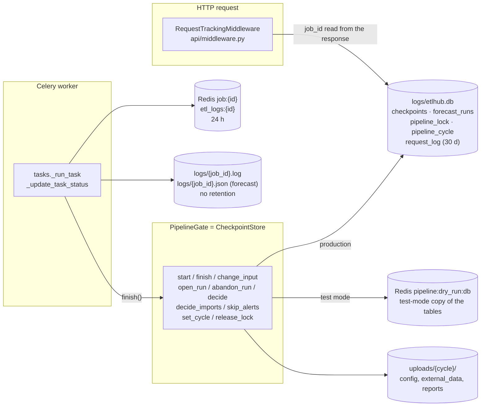

# Cycle journal (option B)

> **Status: implemented on 2026-10-19.** Decisions in [§ 9](#9-decisions). § 4 to § 6 describe what was built.
> Against the first proposal, the link to the request and the actor go through a per-request context
> (`core/request_context.py`, § 4.4) instead of new ids and new method arguments, and the server has no filters (§ 5.1).

A cycle (one month of pipeline, see [../pipeline-checkpoints/pipeline-checkpoints-summary.md](../pipeline-checkpoints/pipeline-checkpoints-summary.md#the-cycle))
is made of 3 steps and about 80 items, each launched, finished, relaunched, reset or decided by a person.
Today etlhub keeps **the latest state** of each item, not **what happened**. This proposal adds a **journal**:
the ordered history of a cycle, linked to the HTTP requests and job logs etlhub already stores.

| § | Content |
|---|---|
| 1 | Need and scope |
| 2 | What already exists (data map) |
| 3 | Gaps |
| 4 | Design: an append-only event table |
| 5 | Reading the journal (API, etlui) |
| 6 | Impact on the existing code |
| 7 | Existing rules re-evaluated |
| 8 | Migration plan |
| 9 | Decisions |

---

## 1. Need and scope

For a given cycle, answer without reading the code or the server:
- what was launched, when it started and ended, with which result, **every attempt included**;
- which human decisions were taken (`approve`, `reject`, `approve_imports`, `skip_alerts`, abandon, reopen with `confirm`);
- what was reset, and because of what;
- for each event, the HTTP request that caused it and the job logs it produced.

Out of scope: a log aggregation platform, metrics, alerting, full-text search in the logs.

## 2. What already exists (data map)



| Data | Store | Lifetime | Joins on |
|---|---|---|---|
| Item state (`status`, `job_id`, `updated_at`) | `checkpoints` | permanent | `cycle`, `job_id` |
| Forecast runs (`opened_at`, `closed_at`, `state`) | `forecast_runs` | permanent | `cycle`, `couple` |
| HTTP requests (method, url, status, duration, error, `job_id`) | `request_log` | **30 days** (`RETENTION_DAYS`) | `job_id` (only when the response carries one) |
| Job record (`status`, `started`, `message`) | Redis `job:{id}` | **24 h** | `job_id` |
| Job logs | Redis `etl_logs:{id}` (24 h) + `logs/{job_id}.log` | file: permanent | `job_id` |
| Forecast final status | `logs/{job_id}.json` | permanent | `job_id` |
| Kept inputs and reports | `uploads/{cycle}/` | permanent | `cycle` |

**All pipeline writes go through one class**, `CheckpointStore` (`infrastructure/checkpoint_store.py`), inside SQLite
transactions. That is the single place a journal has to be written from.

## 3. Gaps

| # | Gap | Where it comes from |
|---|---|---|
| G1 | **No attempt history.** A relaunch overwrites `job_id` and `updated_at`; a reset **deletes** the row. | `_upsert`, `_reset` |
| G2 | **Launch time lost.** `finish()` overwrites `updated_at`; `started` lives 24 h in Redis (on disk only for forecasts). | `checkpoints` schema, `JobStore` |
| G3 | **Decisions have no `job_id`.** `approve`, `approve_imports`, `skip_alerts` write `job_id = NULL`; `abandon_run`, `open_run`, `set_cycle` write no checkpoint. They cannot be joined to their request. | `decide`, `decide_imports`, `skip_alerts`, ... |
| G4 | **Retention mismatch.** Cycles are kept forever, `request_log` 30 days. | `request_tracker.py` |
| G5 | **Silent automatic actions.** The automatic abandon of a run on month change, and `release_lock` turning a checkpoint into `error`, leave no trace of *why*. | `_abandon_other_cycles`, `release_lock` |
| G6 | **Refusals are not tied to a cycle.** A 409 is in `request_log` without `job_id` or cycle. | by design: "a refusal never writes anything" |
| G7 | **No actor.** `request_log` has `client_host` only, though `get_current_user` knows the DHIS2 user on every pipeline route. | `middleware.py`, `main.py` (`_session`) |
| G8 | **Test-mode logs mixed with production.** `logs/*.log` and `request_log` are shared by both modes; leaving test mode discards the test tables but not these. | `set_mode` |
| G9 | **Blind spots.** `DELETE /output/reset`, the CLI (`./pridec`) and `build_analytics` launched from DHIS2 bypass the gate. | known, see summary |

## 4. Design: an append-only event table

### 4.1 Principle

Every state change already done by `CheckpointStore` **also appends one row** to `pipeline_events`,
**in the same transaction**. Either both are written or neither is. Rows are never updated or deleted
(except by an explicit retention rule, § 7).

The journal stores **facts and links**, never copies of logs: logs stay where they are and are reached by `job_id`.

### 4.2 Table

```sql
CREATE TABLE IF NOT EXISTS pipeline_events (
    id         INTEGER PRIMARY KEY AUTOINCREMENT,  -- order of events, also across equal timestamps
    cycle      TEXT NOT NULL,
    at         TEXT NOT NULL,                      -- local ISO timestamp, microseconds (merges the two stores, § 5.1)
    step       TEXT,                               -- NULL for cycle-level events (cycle_chosen, lock_released ...)
    item       TEXT,
    event      TEXT NOT NULL,                      -- vocabulary § 4.3
    job_id     TEXT,                               -- links request_log and logs/{job_id}.log
    actor      TEXT,                               -- DHIS2 username, 'system' or 'worker' (G7, see Q4)
    request_id TEXT,                               -- the HTTP request that caused it (request_log primary key), or NULL
    detail     TEXT                                -- small JSON: confirm, decision, reset items, couple ...
);
CREATE INDEX IF NOT EXISTS ix_pipeline_events_cycle ON pipeline_events(cycle, id);
CREATE INDEX IF NOT EXISTS ix_pipeline_events_job_id ON pipeline_events(job_id);
```

Same file (`logs/etlhub.db`), same `_SCHEMA` string, created by `CREATE TABLE IF NOT EXISTS` like the other tables:
no migration tool needed. In test mode it is written to the Redis blob with the rest, **never to `etlhub.db`**, and
stays in Redis after test mode is left (§ 6.3). No `mode` column: the mode of an event is the store it was read from.

### 4.3 Event vocabulary and write points

| Event | Written by | `job_id` | `detail` |
|---|---|---|---|
| `launched` | `start` | the job | `{"confirm": true}` when confirmed (the dependents it reset: a `reset` event) |
| `succeeded` / `failed` | `finish` | the job | — |
| `reset` | `_reset` (every caller) | causing job, if any | `{"items": [...], "cause": "relaunch" \| "reject" \| "reopen" \| "abandon" \| "input_change"}` |
| `uploaded` / `removed` | `change_input` | `upload_*` / `delete_*` id (already generated) | `{"confirm": true}` when confirmed; the item says which file |
| `decided` | `decide`, `decide_imports` | — (linked by `request_id`) | `{"decision": "approve" \| "reject"}` |
| `skipped` | `skip_alerts` | — | — |
| `run_opened` | `open_run` | — | `{"couple", "confirm"}` |
| `run_closed` | `finish` (post_forecast success) | the job | `{"couple"}` |
| `run_abandoned` | `abandon_run` / `_abandon_other_cycles` | — | `{"couple", "by": "admin" \| "month_change"}` (G5) |
| `cycle_chosen` | `set_cycle` | — | `{"from", "to"}` |
| `lock_released` | `release_lock` | the freed job | `{"task"}` (G5) |
| `cycle_closed` | `finish`, once per cycle, when its success makes the last step done (only a job can complete a cycle) | the job | — (Q7) |
| `mode_changed` | `set_mode`, both directions, written in `etlhub.db` (a production fact: production paused or resumed; no test data in it) | — | `{"to": "test" \| "production"}` (Q6) |

One private helper, `_event(conn, cycle, event, step, item, job_id, detail, actor)`, called next to each existing write
of `CheckpointStore`. `_reset` (the forecast resets) journals what it really deleted; `_delete` is the silent version.

`finish()` must find the step and item of a job **from its `launched` event**, not from `checkpoints`: the checkpoint
row of a job can be deleted by a reset before the job ends.

### 4.4 Request context: linking events to requests (G3)

`core/request_context.py` holds a `ContextVar` with **one dict per HTTP request**, set by `RequestTrackingMiddleware`:
`request_id`, and `actor` written by `get_current_user`. The endpoint runs in a copy of the context, but the dict is the
same object, so what the gate and the 409 handlers write into it reaches the middleware back. Checked with the installed
versions (FastAPI 0.136, Starlette 0.49, anyio 4.13): a value set by the middleware and by an async dependency is seen by
a sync endpoint in the threadpool and by an exception handler, and their writes are seen by the middleware
(`test_the_logged_in_user_is_the_actor_of_the_events`, the middleware tests).

- `_event` stores `request_id` in the event: the journal joins `request_log` on its primary key. No new ids, no change to
  the responses: decisions, uploads, run actions and launches are all linked the same way.
- `_event` sets `pipeline` in the dict: the middleware **always records a request the gate journaled**, whatever
  `TRACKED_ENDPOINTS` says (the local `.env` does not list the pipeline routes, which are `/pipeline/*`, not `/api/...`).
  `GET /pipeline/checkpoints`, polled by etlui, writes nothing and stays governed by the setting.
- An event written to the SQLite file also sets `journal`: the middleware adds `"journal": true` to the log, and the
  `request_log` purge skips such lines (Q2). Test events (Redis) do not: their requests keep the 30-day purge.
- Outside a request (Celery worker, `finish`) the dict is absent: actor `worker`, no `request_id`. A launch is linked
  through its `launched` event, written during the request.
- *ponytail:* the flags are set before the commit; a request refused later in the same transaction (an automatic
  `run_abandoned`, then a 409) is also kept out of the purge. Harmless.

### 4.5 Actor (G7)

`get_current_user` writes `user["username"]` into the request context; `_event` reads it. No gate method changed
signature. Automatic actions write `system` (`run_abandoned` on month change), the worker `worker`. Decided (Q4).

### 4.6 Refusals (409)

A refusal writes no event (rule E3 kept). The two 409 handlers in `main.py` write `reason` (and `code:
confirmation_required`) and `pipeline` into the request context: the middleware records the request with them, even
outside `TRACKED_ENDPOINTS`. `RequestLog` (`domain/schemas/tracking.py`) and etlui's `RequestLog` type have the new
optional fields; etlui's Tracking page opens the detail of a refused request and shows the reason. Readable for 30 days.

## 5. Reading the journal

### 5.1 API

`GET /pipeline/cycles/{cycle}/journal` → events of the cycle, oldest first, each with `request`: its `request_log`
entry (method, url, status, duration, error, reason) while it exists, else null. Job logs are read with the existing
`GET /api/tracking/etl-logs/{job_id}` (etlui calls it for job events). `JournalService` (`application/use_cases/`) joins
the gate's events and `RequestTracker.get_many`.

Jobs show at their end only (2026-10-20, `_job_outcomes`, read side): `succeeded`/`failed` take the actor, request
(the 202 launch) and detail of the job's `launched` event, and `launched` is left out, so a running job does not show.
`launched` is kept only for a job freed by `DELETE /pipeline/lock` (its only trace of who launched it). The stored
events do not change: `finish()` still reads `launched`. The CSV goes through the same read.

`GET /pipeline/cycles` (added 2026-10-20) → the cycles that have checkpoints or events, plus the target cycle, newest
first: `{cycle, state, test_state, target, events, test_events, last_at}`. `state` is the production one, `test_state`
that of the test checkpoints still in Redis (null without any: they are discarded when test mode is left). `events`
counts production events, `test_events` those kept in Redis; both and `last_at` leave out `mode_changed` (rules J1, J2).
Feeds the cycle list of the journal page.

`GET /pipeline/cycles/{cycle}/journal.csv` → the same events, one line each, for the supervisor; administrators only (Q10).

No server filters and no pagination: one cycle is a few hundred events and etlui filters them (mode, step).
*ponytail* limit, to revisit if a cycle passes ~2 000 events.

Mode: whatever the current mode, the endpoint reads **both stores**: production events from `etlhub.db`, test events
from the Redis blob **if it still exists**. They are merged by `at` (ids of two databases are not comparable), and each
event gets `mode: "production" | "test"` from its store. The CSV has a `mode` column. If the blob is gone, the journal
shows production only, with no error. Redis down is not handled: the session lives in Redis, so the request gets 401 first.

### 5.2 etlui

`/journal?cycle=YYYYMM` (`views/Journal/JournalView.vue`, `composables/useJournal.ts`), linked from the Dashboard
"Cycle" line and the drawer. On the left (above on small screens), the list of cycles from `GET /pipeline/cycles`,
grouped by year in native `<details>` (the newest year and the selected cycle's year open, J4): month name, complete or
open, "test: open/complete" while test checkpoints exist, "launches go here" for the target, event count, test events,
last activity. A click shows its journal and replaces `?cycle=` in the URL (J3). Without `?cycle=`, the target cycle. On the right, one chronological table (time, step, item, event and its detail, actor, request status),
test events marked, mode and step filters, a click opens the request (`RequestDetail`) and the job logs (`JobLogsPanel`)
as on Tracking, "Export CSV" for administrators. etlui computes nothing: it renders the API response. Not done: the
grouping by step and run of the first proposal (the step filter covers it; add it if the table gets hard to read).

## 6. Impact on the existing code

### 6.1 Files touched

| File | Change |
|---|---|
| `core/request_context.py` (new) | the per-request `ContextVar` (§ 4.4) |
| `infrastructure/checkpoint_store.py` | `pipeline_events` in `_SCHEMA`; `_event`, `_reset`/`_delete`; one event per write; `finish` reads `launched`; `set_mode(false)` empties the test tables and keeps the blob; `journal(cycle)` |
| `domain/interfaces/pipeline_gate.py` | `journal(cycle)` |
| `application/use_cases/journal_service.py` (new) | events + their requests; CSV (stdlib `csv`) |
| `core/dependencies.py` | `get_journal_service` |
| `api/routers/pipeline_router.py` | `GET /pipeline/cycles/{cycle}/journal`, `.../journal.csv` (`require_admin`) |
| `api/middleware.py` | sets the request context; records journaled or refused requests; `reason`, `code`, `journal` in the log |
| `api/auth/dhis2_auth.py` | `get_current_user` writes the actor |
| `main.py` | the 409 handlers write the refusal into the request context |
| `infrastructure/request_tracker.py`, `domain/interfaces/request_tracker.py` | purge skips `journal` lines (`json_extract`); `get_many` |
| `domain/schemas/tracking.py` | `RequestLog.reason`, `RequestLog.code` |
| etlui | `types/pipeline.ts` (`JournalEvent`), `services/pipeline.ts` (`getJournal`, `journalCsvUrl`), `services/api.ts` (`RequestLog.reason`, `code`), `composables/useJournal.ts`, `views/Journal/JournalView.vue`, route, drawer, Dashboard link, `RequestTable` / `RequestDetail` (refusals) |
| Tests | etlhub: `test_checkpoint_store.py` (attempts and resets, refusal writes nothing, actor and request, late finish, month-change abandon, cycle closed once, test journal in Redis), `test_request_tracking_middleware.py`, `test_request_tracker.py`, `test_pipeline_router.py`; etlui: `useJournal.spec.ts`, `JournalView.spec.ts`, `pipeline.spec.ts`, `TrackerView.spec.ts` |

### 6.2 What does not change

- The rules R1 to R6, the lock, the confirmation flow, the `checkpoints` table and `GET /pipeline/checkpoints`.
- The Celery tasks: `finish()` keeps its signature; the event is written inside it.
- Log storage (Redis 24 h + `logs/` files) and the WebSocket stream.

### 6.3 Test mode

Decided (Q6, confirmed 2026-10-19): **test data stays in Redis only, never in `etlhub.db`**; the test journal stays
readable as long as Redis keeps it.

- **During test mode**, events are written to the Redis blob, in the same transaction as the test checkpoints
  (same SQL, same atomicity as production).
- **When test mode is left** (`set_mode(false)`), the blob is **no longer deleted**: inside it, `checkpoints`,
  `forecast_runs`, `pipeline_lock` and `pipeline_cycle` are emptied, `pipeline_events` is kept. `uploads/dry_run/`
  is still deleted. The next test period starts from empty test tables and appends to the same test journal.
- **`mode_changed`** is written in `etlhub.db` on entry and exit: it records who paused and resumed production,
  not test data.
- **Same cycle name in both modes** (`202610` test and production): the store tells them apart (§ 5.1).
- The confirmation message of `set_mode` changes: the test cycle is discarded, its journal stays in Redis.
- **Lifetime**: Redis runs with AOF persistence and no `maxmemory` (`redis.conf`), so nothing is evicted. The test
  journal lives until Redis is flushed or `redis-data/` is deleted. No TTL, no purge endpoint (add one if needed).
- Test-mode request lines in `request_log` are not linked to events in `etlhub.db`, so they keep the 30-day purge:
  an old test event loses its request detail, not the event itself.

The blob is rewritten whole at each transaction (`RedisBlob`, existing *ponytail* note). A test period adds a few hundred
event rows (estimate, not measured), and test periods now accumulate in it. Acceptable for a few thousand rows; past that,
move the test events to a Redis list (append only) at the cost of their atomicity with the test checkpoints.

### 6.4 Dependencies

**None added.** `sqlite3`, `json`, `uuid` (stdlib), FastAPI, Redis and the existing stores. No log library, no
external service.

### 6.5 Maintenance points

- Every future write in `CheckpointStore` must also call `_event`; a missed call silently leaves a hole in the journal (one test per write method prevents it).
- If the pipeline becomes configurable ([../pipeline-config/pipeline-config.md](../pipeline-config/pipeline-config.md)), events must name items the same way; store the config version in `detail` once it exists.

## 7. Existing rules re-evaluated

Each rule below was right for "keep the current state"; the journal asks for "keep what happened".
The *proposal* column is a recommendation; the decisions taken are in § 9.

| # | Existing rule | Conflict with the journal | Proposal |
|---|---|---|---|
| E1 | **A reset deletes the checkpoint row** ("no row = pending"). | History lost (G1). | Keep the rule: `checkpoints` stays the current state, the journal holds the history. No change to `progress()`. |
| E2 | **One row per (cycle, step, item), upserted.** | Same as E1. | Keep. Attempts are counted from `launched` events. |
| E3 | **A refusal never writes anything.** | Refusals are invisible in the cycle (G6), and `request_log` keeps only the 409 status, not the reason. | Keep for pipeline state and journal. **Decided (Q5): the reason is added to `request_log`** (§ 4.6). |
| E4 | **`request_log` retention: 30 days.** Cycles: no retention. | A journal older than a month loses its requests (G4). | **Decided (Q2): request lines linked to a pipeline event are kept out of the purge.** |
| E5 | **Redis job records and logs: 24 h; `logs/*.log`: forever, no retention.** | The journal relies on the files; nothing purges them and nothing marks their mode. | Keep the files as the durable source. **Decided (Q3): no purge.** |
| E6 | **Leaving test mode discards test checkpoints.** And ([summary](../pipeline-checkpoints/pipeline-checkpoints-summary.md#test-mode)): test data is kept "in Redis only, never in `logs/etlhub.db`". | The test journal would go with them (G8). | **Rule kept (Q6): test data stays in Redis only.** Changed: leaving test mode empties the test tables but keeps the test journal in the blob, readable while Redis keeps it. The summary and guide must say so. |
| E7 | **The lock never expires; `DELETE /pipeline/lock` marks the job `error`.** | The `error` looks like a job failure. | Keep the rule, write `lock_released` with the admin as actor (G5). |
| E8 | **Month change abandons the open run silently.** | No trace of why a run disappeared (G5). | Keep the behaviour, write `run_abandoned` with `by: month_change`. |
| E9 | **Decisions are not jobs** (`job_id = NULL`). | No link to their request (G3). | **Done differently: linked by `request_id`** through the request context (§ 4.4); no id added. |
| E10 | **A complete cycle takes no more launches.** | None: a closed journal is final. | Keep. **Decided (Q7): `cycle_closed` event, automatic.** |
| E11 | **`DELETE /output/reset`, the CLI and DHIS2-side `build_analytics` bypass the gate.** | The journal cannot see them (G9). | **Decided (Q8): documented as a known limit.** |
| E13 | **`TRACKED_ENDPOINTS` decides which requests are logged.** | Pipeline writes may not be logged at all, so events cannot be joined to their request. | **Changed: every request the gate journaled or refused is recorded** (§ 4.4, § 4.6). |
| E12 | **Pipeline messages in English; no user identity in pipeline state.** | The journal is read by people, and "who" matters. | English kept. **Decided (Q4): actor = DHIS2 username** (§ 4.5). |

## 8. Delivery

Done on 2026-10-19 in one change, back and etlui together (shared contract rule). Existing cycles have no events:
their journal starts at deployment; their state stays visible in `GET /pipeline/checkpoints?cycle=`. No seeding (Q9).
To do outside this change: update `known-issues.md` if the blind spots (Q8) need to be listed there.

## 9. Decisions

Product and operational decisions, answered on 2026-10-19. They override the defaults written in § 4 to § 8.

| # | Question | Decision | Consequence for the implementation |
|---|---|---|---|
| Q1 | Who reads the journal, and for what? | **Operators and a supervisor.** | etlui view for operators, plus a CSV export of a cycle for the supervisor. English. |
| Q2 | How long must a cycle's requests stay readable? | **As long as the cycle: `request_log` lines linked to a pipeline event are excluded from the 30-day purge.** | The middleware flags the request (`"journal": true` in its log) when it caused a production event; the purge skips `json_extract(data, '$.journal')`. No cross-table query, no migration. Test-mode request lines keep the 30-day purge (their events are in Redis, not in `etlhub.db`). |
| Q3 | Retention of `logs/{job_id}.log`? | **No purge** (current behaviour). | Nothing to change. |
| Q4 | Must the journal name the person who acted? | **Yes, the DHIS2 username.** | `actor` column; routes pass `user["username"]` to the gate (§ 4.5); `worker` and `system` for the rest. |
| Q5 | Must refused actions (409) appear in the journal? | **No, but their reason is kept in `request_log`** (revised 2026-10-19). | Rule E3 unchanged for the journal. The 409 handlers pass the message to the middleware (§ 4.6); `/tracking/requests` shows it for 30 days. |
| Q6 | Keep the test-mode journal when leaving test mode? | **Yes, in Redis only, never in `etlhub.db`; readable while Redis keeps it** (confirmed 2026-10-19). | `set_mode(false)` empties the test tables and keeps `pipeline_events` in the blob; the journal reads both stores; `mode_changed` in `etlhub.db` (§ 6.3). |
| Q7 | Is "cycle complete" an event? | **Yes, automatic.** | `cycle_closed` written in the transaction where the last step becomes done, with the actor of that action. |
| Q8 | `DELETE /output/reset` and the CLI? | **Documented as a known limit.** | No behaviour change; the journal view and `known-issues.md` say what it cannot see. |
| Q9 | Seed a journal for existing cycles? | **No.** | The journal starts at deployment. |
| Q10 | Who may read and export? | **Read: every logged-in user. CSV export: administrators only** (DHIS2 authority `ALL`). | JSON endpoint under the session dependency; CSV endpoint with `require_admin`. |
| Q11 | Journal per run? | **CSV of a whole cycle.** The `couple` filter stays on the JSON endpoint for the view. | `GET /pipeline/cycles/{cycle}/journal.csv`, stdlib `csv`. |
| — | Tracking | **Pipeline requests always tracked** (2026-10-19). | Implemented as: every request the gate journaled or refused, whatever `TRACKED_ENDPOINTS` says; the polled `GET /pipeline/checkpoints` unchanged. |
| — | Delivery | **Back and etlui view in the same change** (shared contract rule). | Steps 2 to 5 of § 8 ship together. |
| J1 | Which cycle state does the list show in test mode? | **Both** (2026-10-20): production `state`, plus `test_state` while test checkpoints exist in Redis. | `cycles()` computes both; the card shows "test: open/complete" under the production state. |
| J2 | Count `mode_changed` as events? | **No** (2026-10-20): counts measure the pipeline's work. | `events`, `test_events` and `last_at` leave it out; it stays in the journal itself. A cycle used only in test shows "0 events +N test". |
| J3 | Does the URL follow the selected cycle? | **Yes, without history** (2026-10-20). | `router.replace` on `?cycle=`: shareable, kept on reload; Back leaves the page. |
| J4 | How is a growing list organised? | **By year** (2026-10-20). | One native `<details>` per year, newest year and the selected cycle's year open. |

Not verified: the size of the test-mode Redis blob with events over many test periods, the value of `TRACKED_ENDPOINTS`
on the deployed servers (no longer needed for the journal), and the etlui view against a real etlhub (tests mock the API).
