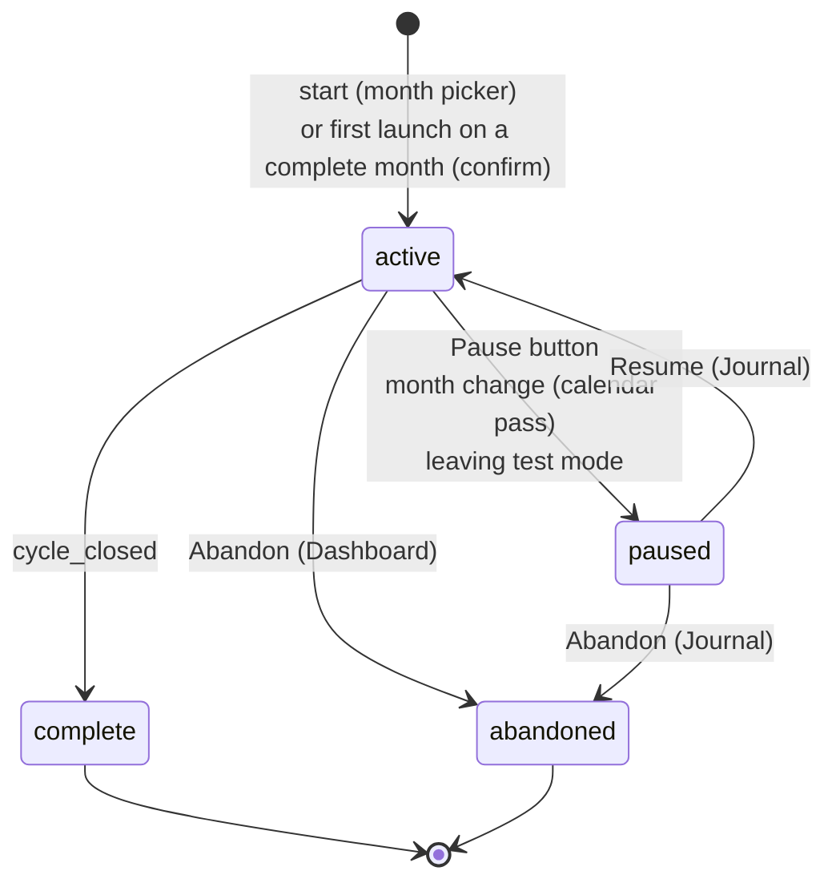

# Cycle passes: redo, pause, resume, abandon

> **Status: implemented on 2026-10-22** (etlhub and etlui together). Product decisions in § 4; what was built, and where
> it differs from § 5 to § 10, in [§ 12](#12-implementation).
> Builds on [../cycle-journal/cycle-journal.md](../cycle-journal/cycle-journal.md) and
> [../pipeline-checkpoints/pipeline-checkpoints-summary.md](../pipeline-checkpoints/pipeline-checkpoints-summary.md).

| § | Content |
|---|---|
| 1 | The problem, seen on cycle 202504 |
| 2 | Cause |
| 3 | What is asked |
| 4 | Decisions |
| 5 | The model: passes and their states |
| 6 | Actions |
| 7 | Journal page |
| 8 | Existing data |
| 9 | Existing rules that change |
| 10 | Use cases |
| 11 | Open points and what was not verified |
| 12 | Implementation |

---

## 1. The problem, seen on cycle 202504

Read on 2026-10-21 from the test journal (Redis blob `pipeline:dry_run:db`, read only) and `logs/etlhub.db`:

| When | Store | Event |
|---|---|---|
| 2026-10-20 11:23 | test | **#144 `cycle_closed`**: the whole test cycle 202504 is complete |
| 2026-10-20 16:33 | production | `mode_changed` to production: the test checkpoints are emptied, the test journal is kept (decision Q6) |
| 2026-10-20 16:33 | production | `cycle_chosen` 202610 → 202504, then `mode_changed` to test |
| 2026-10-20 16:34 | test | #174 `cycle_chosen` 202504, then #175 `import_gee` **launched again from step `data_import`** |
| 2026-10-20 → 21 | test | #175 to #230 appended **to the same journal**, after its `cycle_closed` |

The journal of 202504 shows the cycle `open` again, with a `cycle_closed` in the middle of it. Two runs of the month
cannot be told apart. This is not wanted: **a complete cycle must not continue**. Redoing a month is allowed, but in a
**new journal, with its own unique signature**, without overwriting the previous one.

## 2. Cause

- A cycle is identified **only by its month** (`cycle = 'YYYYMM'`) in `checkpoints`, `forecast_runs` and `pipeline_events`.
- Leaving test mode (`set_mode(false)`) empties the test `checkpoints` but keeps `pipeline_events`
  (`infrastructure/checkpoint_store.py`, `set_mode`). The next test period sees no checkpoint for 202504, so
  `require_open_cycle` lets it start again, and its events go to the journal of the same month.
- In production the same month cannot be redone (rule E10: a complete cycle refuses launches), but nothing allows
  redoing it on purpose either.

## 3. What is asked

1. A complete cycle is frozen. Redoing the month starts a **new pass** with its own journal and a unique signature.
2. An **unfinished** cycle can be **paused** ("stop for now, resume later") with a button on the Dashboard.
3. A paused cycle is **resumed** only from the **Journal** page, with a **Resume** button.
4. An **Abandon** button, at the bottom of the Dashboard **after the System Update section**. An abandoned cycle
   **cannot be resumed**.

## 4. Decisions

Taken on 2026-10-21.

| # | Question | Decision |
|---|---|---|
| P1 | Redo a complete cycle: test only, or production too? | **Test and production.** |
| P2 | What starts a new pass on a complete month? | **The first launch after `cycle_closed`.** An unfinished test period goes on in the same pass. |
| P3 | Form of the signature | **Opaque id** (short UUID), shown with the pass start date. |
| P4 | Events already recorded (202504) | **Split them**: a migration cuts every journal after each `cycle_closed`. |
| P5 | Confirmation for redoing a complete cycle | **Yes, in both modes**: 409 `confirmation_required`, then `confirm=true`. |
| P6 | State of the new pass | **From zero**: step `data_import`, everything pending. The previous pass stays readable. |
| P7 | Kept files (`uploads/{cycle}/`) | **One folder per pass**: `uploads/{cycle}/{pass}/`. Nothing is overwritten. |
| P8 | Several passes of a month in the cycle list | **Month, then its passes** underneath. |
| P9 | How is a pass started? | **The Dashboard month picker is kept.** It starts a pass, only when no pass is active. **Several passes can be paused at once**, on different months or the same month. |
| P10 | Pause with a running job or an open forecast run | **Refused while a job runs** (one job at a time). **An open forecast run stays open** in the paused pass and is continued on resume. |
| P11 | Who may abandon, and can the month be redone after? | **Every logged-in user**, with confirmation. **The month can be redone** in a new pass. |
| P12 | Automatic pause | **On calendar month change**, only for the pass that **follows the calendar**; a pass started by hand on another month (202504 via the picker) stays active. **On leaving test mode**, the active test pass is paused, its state kept in Redis. |
| P13 | Who is attached to a pass, a launch, a run? | **Each one to the logged-in user who triggered it**, visible in the Journal. A pass is started by one user; its launches, runs, decisions, pauses, resumes and abandon can each be done by a different user (2026-10-22). |

## 5. The model: passes and their states

A **pass** is one run of a month. A month has zero, one or several passes; each pass has:

- a signature (opaque id), a start date and **the user who started it** (P13);
- its own journal, checkpoints and forecast runs;
- its own files folder `uploads/{cycle}/{pass}/`;
- a mode: production passes live in `logs/etlhub.db`, test passes in the Redis blob (unchanged split).

| State | Reached by | Allows |
|---|---|---|
| **active** (at most one per mode) | start, resume | launches, decisions, uploads, pause, abandon |
| **paused** (any number) | Pause button, month change, leaving test mode | **Resume** from the Journal, abandon |
| **complete** (frozen) | `cycle_closed` | nothing; the month can be redone in a new pass |
| **abandoned** (frozen, final) | Abandon button | nothing; the month can be redone in a new pass |

Rules:

- **R-P1** Every pipeline write (launch, finish, decision, upload, run) belongs to the **active pass** of the current mode.
  No active pass: every launch is refused, with a message pointing to the month picker or the Journal.
- **R-P2** A frozen pass (complete or abandoned) never receives a new event, except a job that ends after its pass
  was frozen (its `succeeded`/`failed` still goes to the pass that launched it, as `finish()` reads `launched` today).
- **R-P3** One job at a time stays the rule: pause, resume, abandon and start are refused while the lock is held.
- **R-P4** Each transition is a journal event of its pass, with actor and cause:
  `pass_started`, `paused`, `resumed`, `abandoned` (`cause`: `manual`, `month_change`, `test_exit`, `redo`).
- **R-P5** Every action is attached to the logged-in user who triggered it (P13): the pass to the user who started it,
  each launch, run (`run_opened`), decision, upload, pause, resume and abandon to the user who did it. Automatic actions
  are `system`. The user of a pass says nothing about the users of its launches.

  Already true today for events: `actor` = DHIS2 username (`get_current_user` → request context → `_event`), shown in
  the Journal's actor column; `succeeded`/`failed` show the actor of their `launched` event, not `worker`
  (`journal_service._job_outcomes`). New: the pass and its starter. `pass_started` carries the starter, and the cycle
  list shows it without opening the journal.

## 6. Actions

| Action | Where | Who | Conditions | Effect |
|---|---|---|---|---|
| **Start** | Dashboard month picker | logged-in user | no active pass in this mode; no job running; month not in the future | new active pass on that month, from zero |
| **Redo a complete month** | Dashboard: first launch while the picked month's last pass is complete | logged-in user | `confirm=true` after a 409 | new active pass, from zero; the complete pass is untouched |
| **Pause** | Dashboard | logged-in user | an active pass; no job running | pass paused; its open forecast run stays open |
| **Resume** | Journal, on a paused pass | logged-in user | no active pass in the pass's mode; current mode = pass mode; no job running | pass active again; the Dashboard shows its state, open run included |
| **Abandon** | Dashboard (bottom, after System Update) for the active pass; Journal for a paused pass | logged-in user | confirmation; no job running | pass abandoned for good; its open forecast run abandoned too |
| **Automatic pause** | month change, leaving test mode | `system` | — | as Pause, with `cause: month_change` or `test_exit` |

## 7. Journal page

- The cycle list shows **one line per month**, with its **passes underneath**: start date, **started by**, signature,
  state (active / paused / complete / abandoned), mode, event count.
- In a pass's journal, every line shows **who** triggered it (actor column, existing).
- A click on a pass opens **its** journal; the CSV export is per pass.
- A paused pass shows **Resume** and **Abandon**. Resume is disabled, with the reason, when another pass is active or
  the pass belongs to the other mode.

## 8. Existing data

A migration cuts each existing journal after each `cycle_closed`:

- 202504 (test): **pass 1** = events up to #144, complete; **pass 2** = from #174, active or paused depending on the
  mode at migration time.
- The checkpoints of a pass completed before the migration may be gone (202504 pass 1: emptied when test mode was
  left on 2026-10-20). Its state is then read from its journal only.
- Production cycles without `cycle_closed`: one pass each.
- The starter of a migrated pass is the actor of its first event (202504: `tester` for both passes).

## 9. Existing rules that change

| Rule | Today | After |
|---|---|---|
| E10 ([cycle-journal § 7](../cycle-journal/cycle-journal.md#7-existing-rules-re-evaluated)) | a complete cycle refuses every launch | it refuses launches **without confirmation**; with it, a new pass starts |
| E6 / Q6 | leaving test mode empties the test tables, keeps the test journal | leaving test mode **pauses** the test pass and keeps all its state in Redis |
| E8 | month change abandons the open run (`run_abandoned`, `by: month_change`) | month change **pauses** the calendar pass; its run stays open |
| `set_cycle` | chooses the month launches go to | **starts a pass** on that month, only without an active pass |
| `cycle_chosen` | event of the month | replaced by `pass_started` |
| `GET /pipeline/cycles`, `/journal`, `/journal.csv` | per month | per pass (month kept for grouping) |

Contract shared with etlui: both sides change in the same delivery.

## 10. Use cases

Actors: **operator** (logged-in DHIS2 user), **system** (month change, mode change), **worker** (Celery job end).

### UC1 Run a month from start to end

- **Precondition:** no active pass in production.
- **Flow:** the operator picks 202611 in the month picker → pass `a1` starts → steps `data_import`, `forecast`,
  `system_update` → the last success writes `cycle_closed`.
- **Result:** `a1` complete and frozen. Journal: 202611 → `a1` (complete).

### UC2 Redo a complete month

- **Precondition:** 202504 has pass `a1` complete; no active pass.
- **Flow:** the operator picks 202504 and launches `import_gee` → **409** "Cycle 202504 is complete: a new pass will
  start" → the operator confirms → pass `b2` starts from `data_import`, the launch goes to `b2`.
- **Result:** journal 202504 → `a1` (complete, untouched), `b2` (active). Files of `a1` stay in `uploads/202504/a1/`.

### UC3 Pause in the middle of a cycle

- **Precondition:** pass `b2` active, step `forecast`, run ADJ/Malaria open, no job running.
- **Flow:** the operator clicks **Pause** on the Dashboard.
- **Result:** `b2` paused (`paused`, `cause: manual`). The Dashboard shows no active pass; launches are refused; the
  month picker is enabled.

### UC4 Pause refused while a job runs

- **Precondition:** pass active, `forecast` COM/Malaria running (lock held).
- **Flow:** the operator clicks **Pause**.
- **Result:** 409 "forecast (job …) is running: one job at a time". Nothing changes. The operator waits for the end,
  or frees the lock (`DELETE /pipeline/lock`) if the worker died, then pauses.

### UC5 Resume a paused pass

- **Precondition:** `b2` paused; no active pass in its mode.
- **Flow:** the operator opens **Journal** → 202504 → `b2` → **Resume**.
- **Result:** `b2` active (`resumed`). The Dashboard shows step `forecast`, run ADJ/Malaria still open: the operator
  continues where they stopped.

### UC6 Resume refused: another pass is active

- **Precondition:** `b2` paused; `c3` (202611) active.
- **Flow:** the operator clicks **Resume** on `b2`.
- **Result:** refused, with the reason "Pass c3 (202611) is active: pause or abandon it first". The button shows this
  reason before the click.

### UC7 Work on two months in turn

- **Flow:** `b2` (202504) active → Pause → pick 202611 → `c3` starts → … → Pause `c3` → Journal → Resume `b2`.
- **Result:** two paused/active passes alive at once, one active at a time. Each journal holds only its own events.

### UC8 Abandon the active pass

- **Precondition:** `b2` active, run CSB/Malaria open.
- **Flow:** the operator clicks **Abandon** (bottom of the Dashboard) → confirmation dialog → confirm.
- **Result:** `b2` abandoned for good (`abandoned`, `cause: manual`), its run abandoned. No Resume in the Journal.
  202504 can still be redone: picking it starts a new pass.

### UC9 Abandon a paused pass

- **Precondition:** `b2` paused.
- **Flow:** Journal → `b2` → **Abandon** → confirm.
- **Result:** as UC8.

### UC10 Calendar month change

- **Precondition:** pass `d4` started on 202610 by following the calendar, still unfinished on 2026-11-01.
- **Flow:** first pipeline request in November.
- **Result:** `d4` paused (`cause: month_change`, actor `system`); its run stays open. No active pass: the operator
  picks 202611 or resumes `d4` from the Journal.
- **Variant:** a pass started by hand on 202504 is **not** paused by the month change.

### UC11 Leave test mode with an unfinished test pass

- **Precondition:** test mode, test pass `t1` (202504) active.
- **Flow:** the operator switches to production (confirmation).
- **Result:** `t1` paused (`cause: test_exit`), its state kept in Redis. Production goes on with its own passes.
  Back in test mode later: Journal → `t1` → Resume.

### UC12 Resume a test pass from production

- **Precondition:** production mode; `t1` (test) paused.
- **Flow:** the operator opens the Journal and looks at `t1`.
- **Result:** Resume disabled, reason "Test pass: switch to test mode first". The journal stays readable.

### UC13 Same month in production and in test

- **Flow:** production pass `p1` on 202504 and test pass `t1` on 202504 exist.
- **Result:** the Journal shows 202504 with both passes, each marked with its mode. Pausing or abandoning one never
  touches the other (two stores).

### UC14 A job ends after its pass was abandoned

- **Precondition:** impossible through the buttons (abandon is refused while a job runs). Possible after
  `DELETE /pipeline/lock` on a job still alive, then Abandon.
- **Result:** the late `succeeded`/`failed` goes to the abandoned pass (R-P2); it does not reopen it.

### UC15 Read and export a past pass

- **Flow:** the supervisor opens Journal → 202504 → `a1` → reads the events, opens a request and the job logs →
  **Export CSV** (administrators).
- **Result:** the CSV holds `a1` only, not `b2`.

### UC16 Launch with no active pass

- **Precondition:** every pass paused, complete or abandoned.
- **Flow:** a launch is sent (old etlui tab, API call).
- **Result:** 409 "No active cycle: start one with the month picker or resume one from the Journal". Nothing written.

### UC17 Several users on one pass

- **Flow:** `alice` starts pass `e5` on 202611 → `alice` launches `import_gee` → `bob` launches `import_pivot_com`
  and approves the imports → `carol` opens run COM/Malaria and launches its `forecast` → `bob` pauses → `alice` resumes
  from the Journal.
- **Result:** the cycle list shows `e5` started by `alice`. The journal of `e5` shows each line with its user:
  `import_gee` alice, `import_pivot_com` bob, `decided` bob, `run_opened` carol, `forecast` (succeeded) carol,
  `paused` bob, `resumed` alice.

### UC18 Automatic actions

- **Flow:** the calendar month changes during pass `e5`.
- **Result:** `paused` (`cause: month_change`) shows actor `system`; `e5` keeps `alice` as its starter.

## 11. Open points and what was not verified

- The test-mode Redis blob grows with every test pass (state is no longer emptied on exit). Its size over many passes
  is not measured (same open point as the journal).
- `DELETE /output/reset`, the CLI and DHIS2-side `build_analytics` still bypass the gate (known limit Q8 of the journal).
- Abandon from the Journal (UC9) was proposed, not explicitly confirmed.
- The 202504 data was read on 2026-10-21; the mode at migration time decides whether its pass 2 is active or paused.
- Not verified: the migration of the real test blob (Redis was down on 2026-10-22; the production copy of
  `logs/etlhub.db` was migrated in a scratch folder: 202610 became one paused pass, 202504 has none yet in production);
  the etlui pages in a real browser against a real etlhub (the tests mock the API); the SQLite version of the Docker
  image (`RENAME COLUMN` needs 3.25+, the venv has 3.40).

## 12. Implementation

Done on 2026-10-22, shortest path through the existing store (`infrastructure/checkpoint_store.py`).

**Storage.** One table `passes (id, cycle, state, started_at, started_by)` per store (SQLite file, test blob), with a
unique index on the active state. `checkpoints.cycle` and `forecast_runs.cycle` became `pass_id` (`RENAME COLUMN`: the
primary keys follow, no table rebuild); `pipeline_events` got a `pass_id` column and keeps `cycle` for grouping. The
one open run is now one per pass (`one_open_run_per_pass`). `pipeline_cycle` stays the target month.

**Where every write goes.** `_current()` returns the active pass. A launch (`start`) without one starts a pass on the
target month; after a complete pass only with `confirm=true` (409 `confirmation_required`, impact
`{cycle, complete_pass}`); a month whose last pass is paused refuses launches ("resume it from the Journal, or choose
another cycle"). Uploads, runs and decisions never start a pass. The calendar pass is the one whose month is still the
target: `_settle()`, run by every request, pauses the active pass once its month is no longer the target (no flag).

**Routes.** `POST /pipeline/passes/current/pause`, `POST /pipeline/passes/{id}/resume`,
`POST /pipeline/passes/{id}/abandon` (every logged-in user), `GET /pipeline/passes/{id}/journal(.csv)`,
`GET /pipeline/cycles` → `[{cycle, target, passes[...]}]`, `GET /pipeline/checkpoints` returns `pass` and takes
`?pass_id=` (was `?cycle=`), so does the run report. `PUT /pipeline/mode` lost `confirm`: nothing is discarded any more.

**etlui.** Dashboard: the pass and its starter on the Cycle line, the month picker disabled while a pass is active,
"Pause the cycle" and "Abandon the cycle" (confirm dialog) after System Update. Journal (`?pass=<id>`): months with
their passes, Resume and Abandon on a paused pass, Resume disabled with the reason while another pass of its mode is
active; the mode filter is gone (a pass lives in one mode).

**Migration** (`_migrate_to_passes`, once per store, inside the first transaction): each month's events are cut after
each `cycle_closed`; `mode_changed` and `cycle_chosen` never start a pass. Checkpoints and kept files
(`uploads/<cycle>/*` → `uploads/<cycle>/<pass>/`) go to the month's last pass, each forecast run to the last pass
started before it opened. The last pass is complete if its checkpoints are, active if its month is the target, else
paused. A month with checkpoints but no events (before the journal) gets one pass, `started_by` null.

Differences from § 5 to § 10:

- **Start** is not a separate action: the first launch on the chosen month starts the pass (§ 6 "Start"). UC16 holds
  for a month with a paused pass; a month with no pass just starts one.
- A month with a paused pass cannot start a second pass until that one is resumed or abandoned: two paused passes of
  one month (P9) only come from the migration.
- **Resume** of a pass whose open run lost its files (another run opened since and emptied `input/` and `output/`)
  resets that run's items and restores its kept config and external_data: the fetches are redone. Only runs of the same
  mode are seen (test and production share `input/`, `ponytail:` note).
- **Abandon** keeps the pass's checkpoints as they were (readable); only its open run is marked abandoned.
- `mode_changed` is written in the active production pass, or with no pass (then in no journal).
- `set_cycle` is no longer journaled (`cycle_chosen` dropped): `pass_started` says who started the pass.
- The test journal is read through a transaction that saves the blob back (`ponytail:` note in `_test_journal`).

Checks: `tests/infrastructure/test_checkpoint_store.py` (redo with confirm, month change pause, chosen month, pause and
resume, resume after another run, abandon, test exit, one user per action, migration of a month-keyed db),
`tests/api/test_pipeline_router.py` (the routes); etlui `JournalView.spec.ts`, `Dashboard.spec.ts`, `pipeline.spec.ts`.
