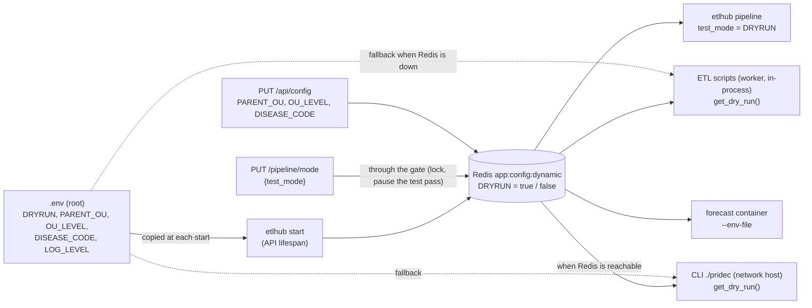

# Merging DRYRUN and TEST_MODE, with the runtime config in Redis

> **Status: analysis, 2026-10-22. Not implemented, not decided.** Open questions in § 8.
> Builds on [../dry-run/dry-run.md](../dry-run/dry-run.md) (current state) and
> [../cycle-passes/cycle-passes.md](../cycle-passes/cycle-passes.md) (leaving test mode pauses the test pass).

| § | Content |
|---|---|
| 1 | Need |
| 2 | Today |
| 3 | History: this was merged once already |
| 4 | Target |
| 5 | Use cases |
| 6 | What changes, and what does not |
| 7 | Risks |
| 8 | Open questions |
| 9 | Corrections to dry-run.md found on the way |

---

## 1. Need

1. When etlhub starts, `DRYRUN` from the root `.env` becomes the default of `TEST_MODE`.
2. `DRYRUN` is the name the CLI and the ETL scripts know; `TEST_MODE` the name etlhub and etlui use. They are **one
   value**.
3. Switching `TEST_MODE` from etlui / etlhub changes the `DRYRUN` the ETL scripts read, **without editing `.env`**.
   Example: `.env` has `DRYRUN=True`, so etlhub starts in test mode; the operator switches to production in etlui;
   from then on the scripts post to DHIS2 with `dryRun=false`, while `.env` still says `True`.
4. More generally: the runtime values of `.env` are loaded into Redis; etlhub and the ETL scripts read Redis; the Redis
   values are editable from etlhub / etlui.

## 2. Today

Since 2026-10-20 the two are separate (dry-run.md):

| | `DRYRUN` | `TEST_MODE` |
|---|---|---|
| Decides | whether the scripts write to DHIS2 (`?dryRun=`) | where the pipeline state lives (SQLite file or Redis blob) |
| Read by | `etl/scripts/config.py` `get_dry_run()`: Redis hash `app:config:dynamic` first, else process env / `.env`, else `true` | `checkpoint_store.test_mode_enabled()`: Redis key `pipeline:test_mode` |
| Written by | nobody in Redis (the migration deleted it); `.env` by hand; `-e DRYRUN=` for the CLI | `PUT /pipeline/mode` only |
| Changed at runtime | no: `.env` is loaded once per process (`load_dotenv` at import), a worker restart is needed | yes |

The runtime config mechanism the need asks for **mostly exists already**:

- Redis hash `app:config:dynamic` (`infrastructure/config_store.py`), read first by the scripts for
  `_EDITABLE_KEYS = {PARENT_OU, OU_LEVEL, DISEASE_CODE, DRYRUN, LOG_LEVEL}` (`etl/scripts/config.py`), at each call,
  so a change is seen by the next job without restart.
- `GET/PUT /api/config` edits `PARENT_OU`, `OU_LEVEL`, `DISEASE_CODE` in that hash; `PUT /api/config/reload` copies
  those three from `.env` into it (by hand, not at startup).
- The forecast container gets `.env` plus the hash's values (`forecast_runner._build_dynamic_env_file`).
- The CLI container (`compose.yaml`, service `etl`) runs with `network_mode: host`: when Redis runs on the host, the
  CLI's `get_dry_run()` reads the **same hash first**, before its own `-e DRYRUN=`.

So two values for one meaning exist today, and a test cycle with `DRYRUN=false` writes to DHIS2 (dry-run.md, known
gap 3; shown in red in etlui).

## 3. History: this was merged once already

From 2026-10-12 to 2026-10-20, `PUT /pipeline/mode` wrote `DRYRUN` into the Redis hash: that **was** this merge. It
was split on 2026-10-20 because "`.env` was ignored after the first switch" (dry-run.md, History): the operator edited
`.env` and nothing happened. The target below keeps the merge and fixes that complaint with two rules: `.env` is
loaded at **every** etlhub start (§ 4, rule 2), and etlui always shows the value in force next to the `.env` default.

## 4. Target

One value, `DRYRUN` in the Redis hash `app:config:dynamic`. `TEST_MODE` is its name in etlhub and etlui.

Rules:

1. **One value.** `TEST_MODE` = `DRYRUN` in the Redis hash. `test_mode_enabled()` reads `get_dry_run()`; the key
   `pipeline:test_mode` disappears. `TEST_MODE=true` means both: pipeline state in the Redis blob **and** scripts post
   with `dryRun=true`. `TEST_MODE=false`: SQLite file **and** real writes.
2. **`.env` is the default, loaded at each etlhub start.** The API lifespan copies the allowed keys (rule 4) from
   `.env` into the hash, overwriting them; a key missing from `.env` is removed (as `/api/config/reload` does).
   Overwriting is a proposal: see § 8, Q1.
3. **One door per key.** `DRYRUN` changes only through `PUT /pipeline/mode`, because a switch is a pipeline event: refused while a job
   runs, pauses the active test pass, journaled (`mode_changed`). It is **not** added to `PUT /api/config`, which would
   bypass the gate. `PARENT_OU`, `OU_LEVEL`, `DISEASE_CODE` keep `PUT /api/config`.
4. **Allowed keys only.** The `_EDITABLE_KEYS` the scripts already read from Redis: `DRYRUN`, `PARENT_OU`, `OU_LEVEL`,
   `DISEASE_CODE`, `LOG_LEVEL`. **Never** `DHIS_TOKEN`, `PIVOT_TOKEN`, `GEE_*` or any other secret: Redis is persisted
   on disk (AOF, `redis.conf`) and readable by every process that reaches it. `DHIS_URL` / `DHIS_TOKEN` stay in the
   login session (`auth_store`), as today.
5. **One spelling.** Values are written normalised, `true` / `false`. `.env` has `DRYRUN='True'` today; python-dotenv
   strips the quotes, `get_dry_run()` lowercases.
6. **`etl/` is not changed.** `get_dry_run()` already reads the hash first, at each call: the scripts follow the switch
   with no code change and no restart.

## 5. Use cases

**UC1 Start in test mode.** `.env`: `DRYRUN=True`. etlhub starts → hash `DRYRUN=true` → etlui shows test mode;
the scripts post with `dryRun=true`; the pipeline state is in the Redis blob.

**UC2 Switch to production without editing `.env`.** From UC1, the operator switches the mode in etlui →
`PUT /pipeline/mode {test_mode: false}` → refused (409) if a job runs; else the active test pass is paused, hash
`DRYRUN=false`, `mode_changed` journaled. The next job reads `false`: **real writes to the DHIS2 instance of the
login session**. `.env` still says `True`.

**UC3 Restart.** From UC2, etlhub restarts → the hash is reset from `.env`: back to `DRYRUN=true`, test mode
(if Q1 = overwrite). The production pass is not paused by a restart: it stays active in the SQLite file, unseen until
the next switch to production. etlui shows the value in force and the `.env` default.

**UC4 Edit `.env` by hand.** The operator changes `.env` → nothing changes until the next etlhub start (rule 2), or
until a "Reload from .env" action (`PUT /api/config/reload`, extended to the allowed keys; for `DRYRUN` it must go
through the gate as in UC2).

**UC5 CLI while etlhub runs.** `./pridec etl import_pivot_com -e DRYRUN=true` while etlhub is in production
(hash `DRYRUN=false`): the CLI container reaches Redis (network host) and **reads `false`: it writes to DHIS2**,
whatever `-e` says. This is already true today for any `DRYRUN` in the hash; the merge makes it the normal case. See
§ 7 and Q2.

**UC6 CLI without etlhub.** Redis down or not running: `ConfigStore.get_all()` returns `{}`, the CLI reads `-e` /
`.env` as today.

**UC7 Redis hiccup during a job.** A worker job reads `get_dry_run()` while Redis does not answer: it falls back to
`.env`. With `.env` `DRYRUN=True`, it does not write (safe); with `False` in `.env` and test mode in the hash, it
**writes**. Hence the advice: keep `DRYRUN=True` in `.env` (§ 7).

**UC8 Forecast run.** The container gets the hash's `DRYRUN` through its env file. The R code does not read it
(dry-run.md): no effect.

## 6. What changes, and what does not

| Place | Change |
|---|---|
| `etlhub/main.py` (lifespan) | load the allowed `.env` keys into the hash at start (rule 2), reusing the logic of `config_router.reload_config` |
| `infrastructure/checkpoint_store.py` | `test_mode_enabled()` = `dry_run_enabled()` (hash); `write_test_mode()` writes `DRYRUN` in the hash; `TEST_MODE_KEY` and the 2026-10-20 migration (`ponytail:`) deleted |
| `api/routers/config_router.py` | `/reload` covers the allowed keys; `GET` also returns `dry_run` (in force) and the `.env` default, read only |
| `GET /pipeline/checkpoints` | `dry_run` becomes equal to `test_mode`: drop it, or keep it as the `.env` default (contract shared with etlui) |
| etlui `ModeToggle` | one switch; the red "DRYRUN=false while in test" warning disappears; shows the `.env` default |
| etlui `Admin/ConfigView` | shows the values in force and the `.env` defaults |
| `etl/`, `forecast/` | **nothing** (hands-off; not needed) |
| Docs | dry-run.md (superseded), etlhub and etlui `CLAUDE.md`, the endpoint table, `GETTING_STARTED.md` (`DRYRUN` meaning) |

Not changed: the Redis blob of test passes, the gate's rules, the journal, the login session (`DHIS_URL`/`DHIS_TOKEN`).

## 7. Risks

1. **The CLI follows etlhub's mode** (UC5). With etlhub in production, a CLI run meant as a dry run writes to DHIS2.
   Today the same happens only if someone wrote `DRYRUN` into the hash by hand. Mitigation without touching `etl/`:
   document it, and have `./pridec` print the `DRYRUN` it will use (it can read Redis like the scripts do). A real
   fix (`-e DRYRUN` wins) needs `etl/scripts/config.py`, which is hands-off. See Q2.
2. **The lost combination.** Today a production pipeline can run with `dryRun=true` (rehearsal on the real SQLite state
   without writing to DHIS2), and a test pipeline with real writes. After the merge, test ⇔ no writes, production ⇔
   writes. The second combination is the known gap 3 (wanted gone); the first is lost. See Q3.
3. **Fallback to `.env` when Redis fails** (UC7): the scripts silently use `.env`. Keep `.env` at `DRYRUN=True` so a
   failure falls on the safe side.
4. **Restart resets the mode** (UC3, if Q1 = overwrite): a production session ends in test mode after a restart. Safe
   for DHIS2, surprising for the operator; etlui must show it.
5. **Blind spots stay**: `DELETE /output/reset`, the CLI and DHIS2-side `build_analytics` bypass the gate (known
   limit); a CLI run during a switch reads whichever value is in Redis at that moment.

## 8. Open questions

| # | Question | Proposal |
|---|---|---|
| Q1 | At start, overwrite the hash from `.env`, or only fill missing keys? | Overwrite: `.env` is the declared default and a restart goes back to it (fixes the 2026-10-20 complaint). Fill-only keeps a runtime switch across restarts but makes `.env` invisible again. |
| Q2 | CLI while etlhub runs: follow Redis (no change to `etl/`), or `-e DRYRUN` wins (needs `etl/scripts/config.py`)? | Follow Redis, documented, and `./pridec` prints the value in force. |
| Q3 | Accept losing "production state + dry run to DHIS2"? | Yes if nobody rehearses on production state; else keep a separate flag. |
| Q4 | Which keys go to Redis? | The 5 `_EDITABLE_KEYS`. `LOG_LEVEL` editable from etlui too? |
| Q5 | Who may switch the mode? | Today every logged-in user. Production now means real writes: administrators only (`require_admin`)? |
| Q6 | `dry_run` in `GET /pipeline/checkpoints` | Replace by `env_default` (the `.env` value), so etlui shows "default from .env: test". |

## 9. Corrections to dry-run.md found on the way

Read in the code on 2026-10-22, not run:

- `build_analytics` **does** honour `DRYRUN` now: `etl/scripts/build_analytics.py:34` skips `launch_analytics` when
  it is true (dry-run.md known gap 1 and its table say the opposite).
- `pridec_update_key` exists in the installed `pivot_dhis_tools` (`pridec/update_dataStoreKey.py`, imported as
  `pridec_update_key`) and skips its PUT when `dryRun` is true (dry-run.md known gap 2 says it is missing).
- The scripts read the `.env` value once per process (`load_dotenv` at import of `etl/scripts/config.py`), but the
  Redis hash at each call: only a Redis value changes without a restart.

Not verified: the current Redis content (Redis was down), the `.env` value in force on the servers, whether the
deployed CLI image reaches the host Redis (`REDIS_URL` in its environment).
