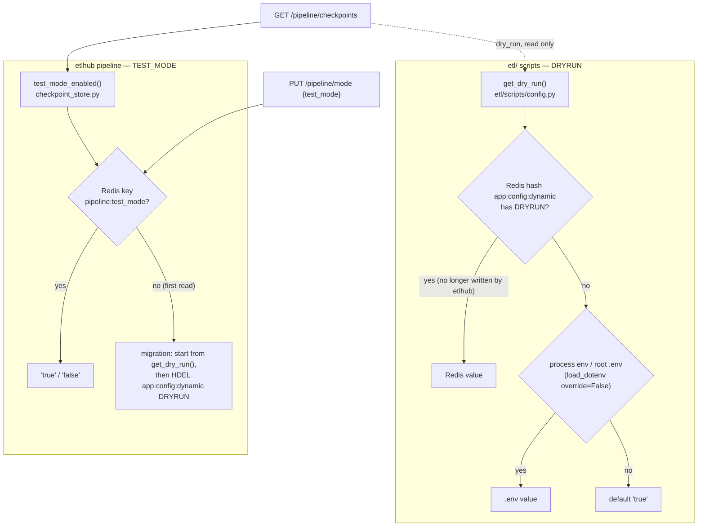
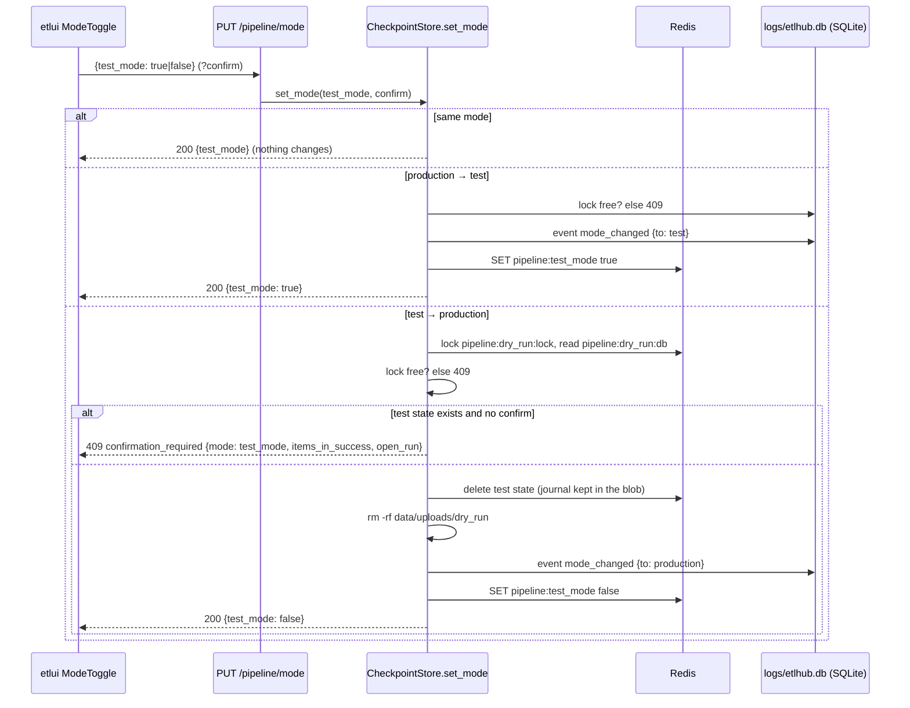

# DRYRUN and TEST_MODE: current state

What the code does today (2026-10-20), not a target design. Related: the test-mode part of
[pipeline-checkpoints.md](../pipeline-checkpoints/pipeline-checkpoints.md), [default-input-files.md](../default-input-files/default-input-files.md).

## In one sentence

Two separate variables since 2026-10-20: **`DRYRUN`** belongs to the ETL scripts (`etl/`) and comes from the root
`.env` only, it decides whether they write to DHIS2 (`?dryRun=true`); **`TEST_MODE`** belongs to etlhub, switched by
`PUT /pipeline/mode`, it decides where the pipeline state lives (Redis instead of the SQLite file).

## History

| Date | What `DRYRUN` was |
|---|---|
| 2026-03-05 (`ff4b523`) | An environment variable of the `etl/` scripts only (`docker compose run --env DRYRUN='True' etl …`): the `dryRun` argument of `post_dataElements` and `pridec_update_key`. |
| 2026-07-21 (`75e18ef`) | Also an editable key of the Redis dynamic config (`_EDITABLE_KEYS` in `etl/scripts/config.py`): Redis wins over `.env`. |
| 2026-10-12 (`3f59358`) | Also etlhub's pipeline test mode: `PUT /pipeline/mode` wrote it to Redis, so `.env` was ignored after the first switch. |
| 2026-10-20 | Split: etlhub's test mode is `TEST_MODE`; etlhub no longer writes `DRYRUN`, `.env` is its only source again. |

## 1. Where each value comes from

- **`DRYRUN`**: `etl/scripts/config.py` still looks in Redis first (`etl/` is not changed), but nothing writes it there
  any more: the migration removes the old key once, then the scripts read the root `.env`. Today: `DRYRUN='True'`
  (python-dotenv strips the quotes). The `pridec` CLI keeps passing it with `-e DRYRUN=…`.
- **`TEST_MODE`**: Redis key `pipeline:test_mode`, written only by `PUT /pipeline/mode`. Not in the dynamic config
  hash, so it never reaches the scripts nor the forecast container.
- **Migration** (`ponytail:` in `test_mode_enabled`): the first read without `pipeline:test_mode` starts in the mode
  the old `DRYRUN` gave (Redis value, else `.env`), so an ongoing test cycle stays visible, then deletes `DRYRUN` from
  the dynamic config. To delete once every deployment has run it.

## 2. Switching the test mode (`PUT /pipeline/mode`)

`DRYRUN` is never touched by this endpoint. The Redis keys `pipeline:dry_run:db` / `pipeline:dry_run:lock` and the
folder `data/uploads/dry_run/` keep their old names: they hold the test state written before the split.

## 3. What each one changes

| Area | Decided by | Off | On |
|---|---|---|---|
| Pipeline state (checkpoints, runs, lock, journal) | `TEST_MODE` | SQLite `logs/etlhub.db` | in-memory SQLite in Redis `pipeline:dry_run:db` |
| Uploaded files kept per cycle | `TEST_MODE` | `data/uploads/<cycle>/` | `data/uploads/dry_run/<cycle>/` (deleted when leaving test mode) |
| Default input files | `TEST_MODE` | production defaults | `assets/test/inputs/` |
| Scripts that post to DHIS2 | `DRYRUN` (.env) | `?dryRun=false`: data written | `?dryRun=true`: DHIS2 validates, saves nothing |
| Forecast container (R) | — | gets `DRYRUN` from `.env` via `--env-file` | same; the R code does not read it |

**The two are independent**: a test cycle with `DRYRUN=false` in `.env` writes to DHIS2. etlui shows the `.env`
value read only under the test-mode switch, in red in that case.

Scripts and `DRYRUN`:

| Script | Reads DRYRUN | Effect of `DRYRUN=true` |
|---|---|---|
| `import_gee` | yes | `post_dataElements(dryRun=True)` |
| `import_pivot_com`, `import_pivot_csb` | yes | `post_dataElements(dryRun=True)`, log line "DRY RUN" |
| `post_forecast` | yes | `post_dataElements(dryRun=True)` |
| `update_key` (`update_pridec_key`) | yes | passed to `pridec_update_key(dryRun=…)`; **not verified**: this function is not in the installed `pivot_dhis_tools` (test-venv) |
| `calc_CSB_alerts` | yes | not exposed (`/calc_orgunit_alerts` is 501) |
| `build_analytics` | **no** | `launch_analytics` POSTs to DHIS2 whatever `DRYRUN` says |
| `fetch_climate`, `fetch_disease`, `fetch_geojson`, `validate_inputs` | no | read DHIS2 / write local files only |

## 4. Endpoints concerned

Not concerned: `/api/auth/*`, `/api/tracking/*`, `/api/config/*`, `/output/*`, `/forecast/status/{job_id}`.

| Endpoint | `TEST_MODE` | `DRYRUN` |
|---|---|---|
| `PUT /pipeline/mode` | **writes** it (section 2) | — |
| `GET /pipeline/checkpoints` | `test_mode` + the state of that mode's store | `dry_run`, read only |
| `GET /pipeline/cycles`, `GET /pipeline/passes/{pass_id}/journal`, `…/journal.csv` | read both stores | — |
| `POST /pipeline/passes/current/pause`, `…/{pass_id}/resume`, `…/{pass_id}/abandon` | that mode's store | — |
| `POST /pipeline/runs`, `DELETE /pipeline/runs/current`, `GET /pipeline/runs/{source}/{disease}/report` | that mode's store; report under its uploads dir | — |
| `POST /pipeline/runs/current/approve`, `…/skip_alerts`, `POST /pipeline/imports/approve` | that mode's store | — |
| `PUT /pipeline/cycle`, `DELETE /pipeline/lock` | that mode's store | — |
| `POST /import_gee`, `/import_pivot_com`, `/import_pivot_csb` (202) | gate in that mode's store | the script posts with `dryRun` |
| `POST /post_forecast`, `/update_key` (200, synchronous) | gate in that mode's store | the script posts with `dryRun` |
| `POST /build_analytics` (202) | gate in that mode's store | **ignored** by the DHIS2 call |
| `POST /fetch_climate`, `/fetch_disease`, `/fetch_geojson`, `/validate_inputs` (202) | gate in that mode's store | — |
| `POST /forecast/` (202) | gate in that mode's store | copied into the container env file (unused by R) |
| `POST /input/files/{name}`, `DELETE /input/files/{name}`, `POST /input/files/{name}/from-default` | `change_input` in that mode's store; uploads under its dir | — |
| `GET /input/defaults`, `GET /input/defaults/{name}/{key}/preview` | defaults of that mode | — |

## Known gaps

1. `build_analytics` has no dry run: it triggers the DHIS2 analytics job whatever `DRYRUN` says.
2. `update_key`: dry-run behaviour of `pridec_update_key` not verified (function missing from the installed package).
3. A test cycle does not force `DRYRUN=true`: with `DRYRUN=false` in `.env`, it writes to DHIS2 (shown in red in etlui).
   The 2026-10-12 target (test mode passes `DRYRUN=True` to `import_gee` and `post_forecast`) is not applied.
4. The forecast env file is built for `docker run --env-file`, which keeps quotes: `DRYRUN='True'` reaches the
   container as `'True'` (harmless, R does not read it).
5. `etl/scripts/config.py` still reads `DRYRUN` from Redis first: anything writing `DRYRUN` to the dynamic config
   again would hide `.env`. Only the migration touches it in etlhub today.
