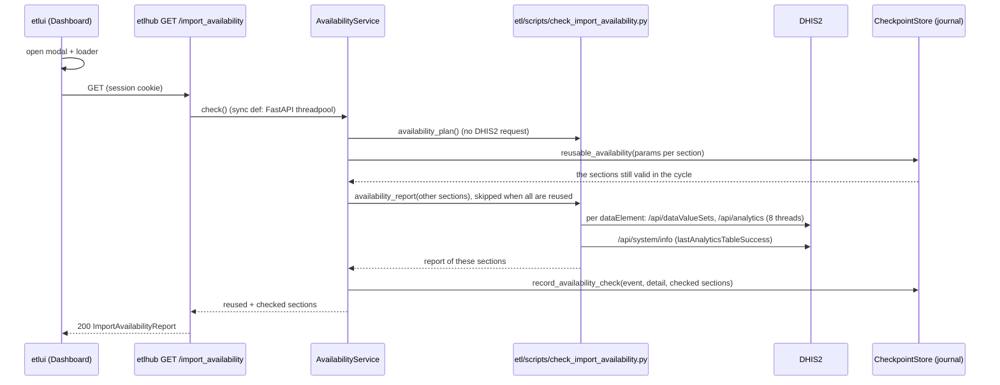

# Import availability: is the imported data already in DHIS2?

> **Status: implemented (2026-10-26).** Decided with the owner on 2026-10-26 (§ 7), shared report added the same day (§ 5).

Step 1 of the pipeline (Data Import) runs `import_gee`, `import_pivot_com` and `import_pivot_csb`, then
`build_analytics`. Before launching them, or before approving the imports, the user wants to know what DHIS2
already has, and whether the analytics tables were built after the last import. Several users follow the same cycle
from different accounts and workstations: a check done by one of them is shared with the others (§ 5).

| § | Content |
|---|---|
| 1 | What the user sees |
| 2 | Flow |
| 3 | What is checked |
| 4 | API |
| 5 | Shared report |
| 6 | Journal and tracking |
| 7 | Limits |
| 8 | Decisions |
| 9 | Files |

---

## 1. What the user sees

On the Dashboard, inside the **Data Import** accordion, a **Details** button sits in the imports approval row, before
the imports approval status (moved there from an "i" button next to the accordion title, 2026-10-26).
A click opens a modal **at once**, with a loader, while etlhub asks DHIS2 (a few seconds). Then one table per import:

| Data element | Aug 2026 | Sep 2026 | |
|---|---|---|---|
| `pridec_historic_COMMalaria` | 67<br><sub>60</sub> | N/A | ✗ (red) |
| `pridec_historic_COMDiarrhea` | 5<br><sub>5</sub> | 6<br><sub>6</sub> | ✓ (green) |

- A cell shows the number of organisation units with a **stored value** (raw data), and below it, smaller,
  how many the **analytics tables** have. The small number turns amber when it differs from the stored one.
- **N/A**: no stored value for that period yet. A row with at least one N/A ends with a red **✗**, otherwise a green **✓**.
- A dataElement whose query failed shows the error across its row (✗).
- Above the tables: the DHIS2 instance and **DHIS2's last analytics build**.
- Above each table: who checked it, when, in which pass, and a **reused** badge when it comes from an earlier check
  of the cycle (§ 5).
- Under a table: one line per dataElement whose analytics are behind ("run Build Analytics").
- **Refresh** checks every section in DHIS2 again (`?refresh=true`); the new check is then the one everyone sees.
- At the bottom of the modal, **Reject** and **Approve imports** (the `approve_imports` decision,
  `POST /pipeline/imports/approve`), moved there from the Data Import row (2026-10-26): the imports are approved on the
  report. Disabled while the report loads; a click closes the modal, then sends the decision.

## 2. Flow



The script reads DHIS2 with **the session's DHIS2 token** (`etlhub/script_config.py`, as every ETL script under etlhub),
and `PARENT_OU` / `GEE_VARIABLES` from the editable config (Redis). It writes nothing to DHIS2.

## 3. What is checked

Same periods and orgUnits as the import scripts (copied in the script, marked `ponytail:`; keep them in sync):

| Import | dataElements | Periods | orgUnits |
|---|---|---|---|
| `import_gee` | `GEE_VARIABLES` (all by default) | the last 3 full months (`calc_date_range(start_months_ago=3)`) | level 6 under `PARENT_OU` |
| `import_pivot_com` | `pridec_historic_COMMalaria`, `_COMRespinf`, `_COMDiarrhea` | `create_period_range(today − 8 months)` | level 6 under `PARENT_OU` |
| `import_pivot_csb` | `pridec_historic_CSBMalaria`, `_CSBRespinf`, `_CSBDiarrhea` | same | the 21 CSB of the import script |

Per dataElement (one request each, so an unknown code or a failing query only marks its row):

| Field | Source | Meaning |
|---|---|---|
| `raw` | `GET /api/dataValueSets?dataElement=<code>&inputDataElementIdScheme=CODE&period=…&orgUnit=…` | orgUnits with a stored value, per period. Up to date as soon as the import ends |
| `analytics` | `get_dataElements` of `pivot_dhis_tools` (`/api/analytics`, `dx_id_scheme="CODE"`) | orgUnits with a value in the analytics tables, per period. Only filled by `build_analytics` |
| `last_updated` | max `lastUpdated` of the stored values | when the data was last imported |
| `imported` | `raw` | a stored value for every period (etlhub decides the ✓, not etlui) |
| `analytics_up_to_date` | `analytics == raw` | `false`: analytics built before the import, run `build_analytics`; `null` if a query failed |
| `error` | — | the error of this dataElement's queries |

`last_analytics` is `lastAnalyticsTableSuccess` of `GET /api/system/info` (server local time, no time zone), `null` if
DHIS2 does not give it.

The CLI keeps working: `docker compose run etl check_availability` logs the same report as `raw/analytics` tables
(always every section, never shared: the CLI has no etlhub store).

## 4. API

`GET /import_availability?refresh=false`, session required. `refresh=true` checks every section again. Sync `def` handler: FastAPI runs it in its threadpool,
so the DHIS2 requests never block the event loop. Not a Celery job (no `job_id`, no lock): it only reads.

**200** `ImportAvailabilityReport` (`etlhub/domain/schemas/etl.py`, mirrored in `etlui/src/types/pipeline.ts`):

```json
{
  "dhis_url": "http://localhost:8082",
  "last_analytics": "2026-10-20T13:36:07.058",
  "imports": [
    {"task": "import_pivot_com", "periods": ["202608", "202609"], "org_units": "ou:LEVEL-6;VtP4BdCeXIo",
     "checked_at": "2026-10-26T11:16:28.123456", "checked_by": "jdoe", "pass_id": "3f9c1a2b", "reused": true,
     "elements": [
       {"code": "pridec_historic_COMMalaria", "raw": {"202608": 67, "202609": 0}, "analytics": {"202608": 60, "202609": 0},
        "last_updated": "2026-10-01T08:52:30.000+0000", "imported": false, "analytics_up_to_date": false, "error": null}
     ]}
  ]
}
```

**500** `{message: "Import availability check failed: ..."}` when the check cannot run at all (missing `PARENT_OU`,
no DHIS2 session). A DHIS2 error on one dataElement is not a 500: it fills that row's `error`.

This is a **new contract** between etlhub and etlui: change both sides together.

## 5. Shared report

etlhub stores every checked **section** (one import) in `availability_checks` (`etlhub.db` in production, the test-mode
copy in Redis in test mode), with its cycle, pass, `checked_by`, `checked_at` (when the check **started**, local time like
the journal) and its parameters: the JSON of `dhis_url`, `task`, `elements`, `periods`, `org_units`
(`availability_plan()`, computed without DHIS2). `org_units` carries `PARENT_OU` (GEE, COM) or `CSB_IDS` (CSB);
`elements` carries `GEE_VARIABLES`, `COM_ELEMENTS` or `CSB_ELEMENTS`.

At each opening, per section, `reusable_availability` returns the **latest** stored check that still holds:

| Rule | Detail |
|---|---|
| Same cycle | the cycle the Dashboard shows, **any pass** of it (and checks made before its first launch) |
| Same parameters | the JSON above, byte for byte (keys sorted) |
| At most 30 days old | older rows are deleted at each new check |
| Its import not launched since | no `launched` event of that import (`import_gee`, `import_pivot_com` or `import_pivot_csb`) in the cycle after `checked_at`, **from its launch**, whatever its outcome. `build_analytics` does not invalidate |

Only the sections without a valid check ask DHIS2. `last_analytics` comes from the check that asked DHIS2, else from
the latest reused section. Test mode and production never share: they are separate stores.

## 6. Journal and tracking

Each opening writes one event (step `data_import`, no item, no job) through `PipelineGate.record_availability_check`:
`availability_checked` when DHIS2 was asked for at least one section, `availability_reused` when every section was reused.

- in **the pass the Dashboard shows** (`_shown`: the active one, else the last of the target month), even while a job
  holds the lock: a read takes no lock and writes no checkpoint;
- before the month's first launch there is no pass: the event keeps `pass_id` null and shows in no journal
  (like `mode_changed`), and a check never starts a pass;
- detail `{"checked": [...], "reused": [...], "missing", "analytics_behind", "errors"}` (the lists only when not empty,
  counts of dataElements over every section), or `{"error"}` when the check could not run;
- both events are left out of a pass's `events` count and `last_at` (`cycles()`), like `mode_changed`: a read is not
  pipeline work.

A journaled request is tracked by `RequestTrackingMiddleware` whatever `TRACKED_ENDPOINTS` says (`context["pipeline"]`),
so every check also shows in the Tracking page.

## 7. Limits

- **Copied constants**: periods, CSB ids and dataElement codes are copied from the three import scripts
  (they are defined inside their functions). An import script change must be copied here too.
- **Descendants**: the raw query on `PARENT_OU` uses `children=true`, which counts every descendant, not only level 6.
  The imported dataElements only have level-6 values today (`ponytail:` comment in the script).
- **Duration**: around 2.5 s on the local DHIS2 (8 + 2 × N requests, 8 threads). A slow DHIS2 makes the loader longer;
  each request has the scripts' usual 600 s timeout.
- **Server time**: `last_analytics` is in DHIS2's local time and `last_updated` in UTC: they are shown, not compared.
- **Access**: every logged-in user, for now (§ 8, Q6).
- **Shared analytics column**: `build_analytics` does not invalidate a stored check (Q10), so a reused section keeps the
  analytics counts of its check. Its date is shown; Refresh updates it.
- **Mixed times**: when one section is checked again, `last_analytics` is newer than the analytics counts of the
  reused sections. Each section's date shows it.
- **Imports outside etlhub** (CLI, DHIS2 itself) invalidate nothing: etlhub does not see them. Refresh after one.
- **Two users at once** without a valid check both ask DHIS2; both checks are stored, the latest wins. Harmless: read only.

## 8. Decisions

| # | Question | Decision (2026-10-26) |
|---|---|---|
| Q1 | Raw data or analytics? | **Both**: raw to know whether the import happened, analytics to know whether `build_analytics` ran after it |
| Q2 | Which periods? | **Those of the import scripts** (relative to today), not the cycle's month, for now |
| Q3 | Sync endpoint or Celery job? | **Sync**; etlui opens the modal at once with a loader |
| Q4 | Cache? | **None** at first; replaced by the shared report (Q8 to Q12) |
| Q5 | Display | Counts in a table; **N/A** when not imported, red **✗** at the end of the row |
| Q6 | Who? Traced? | **Every logged-in user**; traced in the **tracking and the cycle journal** |
| Q7 | Route | `GET /import_availability` |
| Q8 | Why share? | Several users on the same cycle (accounts, workstations): do not redo a check already done |
| Q9 | Shared between | **The passes of the same cycle** |
| Q10 | What invalidates a stored check? | **A launch of its import** from Data Import, from the launch on, that section only. `build_analytics` does not. **30 days** at most |
| Q11 | Parameters compared | `PARENT_OU`, `CSB_IDS`, `COM_ELEMENTS`, `CSB_ELEMENTS`, plus periods, `GEE_VARIABLES`, `dhis_url` and the mode |
| Q12 | Several valid checks | **The most recent**; a reuse is journaled `availability_reused` |

### To be determined (2026-10-26)

- **Role of the approval made under this report**: open questions in
  [../pipeline-checkpoints/pipeline-checkpoints.md](../pipeline-checkpoints/pipeline-checkpoints.md) § 6
  (`approve_imports` role).
- **Carrying Data Import over to a new pass of the same cycle** when the parameters are the same, so its items are
  done at once and skippable: open questions in [../cycle-passes/cycle-passes.md](../cycle-passes/cycle-passes.md) § 11.
  This report's parameters (§ 5) are a candidate for "same parameters".

## 9. Files

| Side | File |
|---|---|
| etl | `etl/scripts/check_import_availability.py` (`availability_plan()`, `availability_report(tasks)` + CLI), `etl/cli.sh` (`check_availability`) |
| etlhub | `api/routers/etl/ingest_router.py` (route), `application/use_cases/availability_service.py`, `domain/schemas/etl.py`, `domain/interfaces/pipeline_gate.py` + `infrastructure/checkpoint_store.py` (table `availability_checks`, `reusable_availability`, `record_availability_check`), `core/dependencies.py` |
| etlhub tests | `tests/api/test_import_availability.py`, `tests/infrastructure/test_checkpoint_store.py` |
| etlui | `services/pipeline.ts` (`getImportAvailability`), `types/pipeline.ts`, `composables/useImportAvailability.ts`, `views/Dashboard/components/ImportAvailabilityDialog.vue`, `Dashboard.vue` (Details button), `PreviewDialog.vue` (its frame: optional badge, `loadingLabel`, `actions` and `footer` slots), `Journal/JournalView.vue` (event colour) |
| etlui tests | `services/__tests__/pipeline.spec.ts`, `composables/__tests__/useImportAvailability.spec.ts`, `views/Dashboard/__tests__/Dashboard.spec.ts` |
