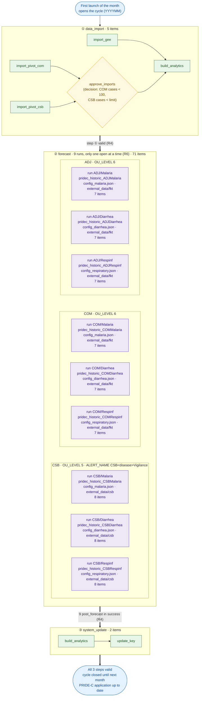
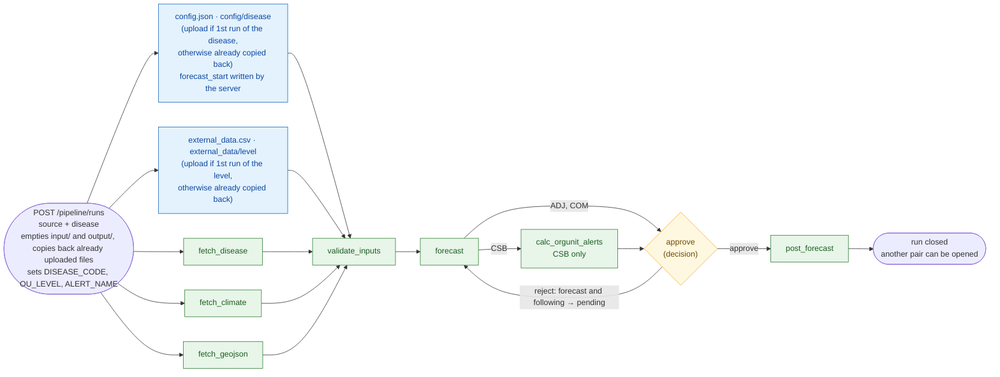
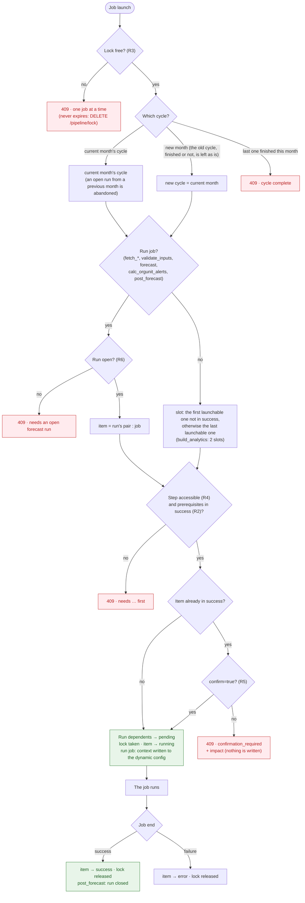
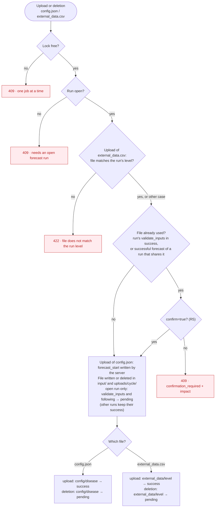
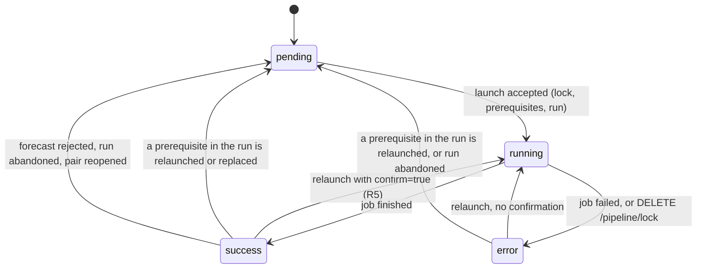
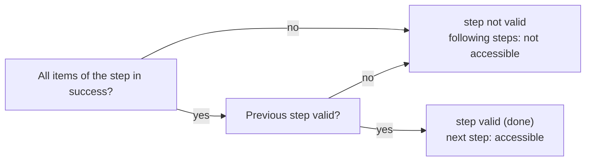
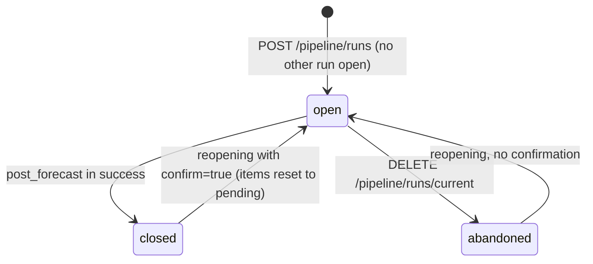

# Checkpoint control: diagrams

This document gathers, as diagrams, everything etlhub controls (target design, revised 2026-10-12).
The workflow (3 phases, `pridec` commands, step order) follows the **reference documentation** (`pivot_forecast.sh`), which is authoritative;
this document only adds etlhub's control layer on top of it (lock, checkpoints, cycles, confirmations).
The rules are summarized in [pipeline-checkpoints-guide.md](pipeline-checkpoints-guide.md), and the full design is in [pipeline-checkpoints.md](pipeline-checkpoints.md).

> Implemented except `calc_orgunit_alerts` (still 501), the test-mode scope and the level check of `external_data`:
> see the status at the top of [pipeline-checkpoints.md](pipeline-checkpoints.md).

| # | Diagram | Question |
|---|---|---|
| 1 | The full path | Which steps, which items, and the 9 forecast runs in detail? |
| 2 | A forecast run | How does a pair go from opening to `post_forecast`? |
| 3 | Launch control | What does the server check before accepting a job? |
| 4 | Input files | What happens when `config.json` or `external_data.csv` is uploaded or deleted? |
| 5 | The life of an item | How does an item go from `pending` to `success`, and how does it go back? |
| 6 | The life of a run and of a cycle | When do they open and when do they close? |

| Rule | Content |
|---|---|
| R1 | Every item is mandatory; `config.json` is one item per disease; `external_data.csv` is one item per level (fkt, csb). Both are uploaded from the user interface. |
| R2 | An item requires its prerequisites to be in `success`. |
| R3 | Only one job at a time. The lock never expires (`DELETE /pipeline/lock`). |
| R4 | A step is valid only if all its items are in `success` and the previous step is valid. |
| R5 | Undoing something that was validated requires `confirm=true`. |
| R6 | Only one forecast run open at a time. |

---

## 1. The full path of a cycle

Legend:
- **Green**: an item, with a status in the database.
- **Yellow**: a human decision (item).
- **Purple**: a forecast run, summarized here; its detail is in diagram 2.
- **Solid arrow**: prerequisite checked by the server (R2).
- **Double arrow**: transition from one step to the next (R4).

Each run box shows the input files it uses; the uploads themselves are detailed in diagram 2.

> **When do uploads happen?** There is no upload step: files are uploaded from the user interface **during the runs**,
> one at a time, and they are **all mandatory**. `config.json` is uploaded in the **first open run of the disease** (ADJ, COM or CSB, whichever comes first),
> then automatically copied back into `input/` for its 2 other runs; the server writes `forecast_start` into it, as `jq` does in `pivot_forecast.sh`.
> Same principle for `external_data.csv`, **per level**: uploaded in the first run of the level (fokontany: ADJ or COM; CSB), then copied back to the other runs of that level.
> Over one cycle, that makes 3 uploads of `config.json` and 2 of `external_data.csv`. The files in the repository's `assets/` are offered as defaults ([../default-input-files/default-input-files.md](../default-input-files/default-input-files.md)).

> **`build_analytics`** must go through the etlhub API. If launched manually from the DHIS2 interface, etlhub does not see it and step ① stays invalid.

### The 9 runs

| # | Run | `DISEASE_CODE` | `OU_LEVEL` | `ALERT_NAME` | Config item (expected file) | external_data item | Items in the run |
|---|---|---|---|---|---|---|---|
| 1 | `ADJ/Malaria` | `pridec_historic_ADJMalaria` | 6 (fokontany) | — | `config/Malaria` (`config_malaria.json`) | `external_data/fkt` | 7 |
| 2 | `ADJ/Diarrhea` | `pridec_historic_ADJDiarrhea` | 6 | — | `config/Diarrhea` (`config_diarrhea.json`) | `external_data/fkt` | 7 |
| 3 | `ADJ/Respinf` | `pridec_historic_ADJRespinf` | 6 | — | `config/Respinf` (`config_respiratory.json`) | `external_data/fkt` | 7 |
| 4 | `COM/Malaria` | `pridec_historic_COMMalaria` | 6 | — | `config/Malaria` (`config_malaria.json`) | `external_data/fkt` | 7 |
| 5 | `COM/Diarrhea` | `pridec_historic_COMDiarrhea` | 6 | — | `config/Diarrhea` (`config_diarrhea.json`) | `external_data/fkt` | 7 |
| 6 | `COM/Respinf` | `pridec_historic_COMRespinf` | 6 | — | `config/Respinf` (`config_respiratory.json`) | `external_data/fkt` | 7 |
| 7 | `CSB/Malaria` | `pridec_historic_CSBMalaria` | 5 (CSB) | `CSBMalariaVigilance` | `config/Malaria` (`config_malaria.json`) | `external_data/csb` | 8 |
| 8 | `CSB/Diarrhea` | `pridec_historic_CSBDiarrhea` | 5 | `CSBDiarrheaVigilance` | `config/Diarrhea` (`config_diarrhea.json`) | `external_data/csb` | 8 |
| 9 | `CSB/Respinf` | `pridec_historic_CSBRespinf` | 5 | `CSBRespinfVigilance` | `config/Respinf` (`config_respiratory.json`) | `external_data/csb` | 8 |

The upload interface shows the expected file for each disease (in particular `config_respiratory.json` for `Respinf`).

In total, step ② has 71 items: 3 `config/<disease>` + 2 `external_data/<level>` + 6 × 7 + 3 × 8.
Uploads per cycle: 3 `config.json` and 2 `external_data.csv`, all mandatory.

---

## 2. A forecast run

The same model applies to all 9 pairs. Arrows are checked prerequisites (R2).

Legend: **green** = item; **blue** = upload (item); **yellow** = human decision.
What each job reads and writes:

| Item | Reads | Writes |
|---|---|---|
| `config/<disease>` (upload, once per disease) | — | `input/config.json`, with `forecast_start` written by the server; kept and copied back for the disease's other runs |
| `external_data/<level>` (upload, once per level) | — | `input/external_data.csv`, kept and copied back for the other runs of the same level |
| `fetch_disease` | `DISEASE_CODE`, `OU_LEVEL`, `PARENT_OU` | `input/disease_data.json` |
| `fetch_climate` | `OU_LEVEL`, `PARENT_OU` | `input/climate_data.json` |
| `fetch_geojson` | `OU_LEVEL`, `PARENT_OU` | `input/orgUnit_poly.geojson` |
| `validate_inputs` | the files above | `input/config_valid.json`, `input_valid.json`, `polygon_valid.geojson` |
| `forecast` | the 3 `*_valid` files | `output/forecast.json`, `output/forecast_report.html` |
| `calc_orgunit_alerts` (CSB) | `ALERT_NAME` | alert thresholds (CLI command `pridec etl calc_orgUnit_alerts`) |
| `approve` | `output/forecast_report.html` (read by the user) | decision |
| `post_forecast` | `output/forecast.json` | DHIS2 (PRIDE-C) |

**Abandon** (`DELETE /pipeline/runs/current`): the run becomes `abandoned`, its items go back to `pending`, nothing is published.

**Invalidation within the run**: relaunching or replacing an item resets everything that depends on it to `pending`
(for example, relaunching `fetch_climate` resets `validate_inputs`, `forecast`, … to `pending`).

---

## 3. Launch control

This path applies to every job launch: Celery (`/import_*`, `/fetch_*`, `/validate_inputs`, `/build_analytics`,
`/forecast/`), synchronous (`/post_forecast`, `/update_key`), and `/calc_orgunit_alerts`. Everything happens in a single SQLite
transaction (`BEGIN IMMEDIATE`); a refusal writes nothing.

**Opening a run** (`POST /pipeline/runs`) goes through the same first checks (lock, cycle), then:
step ② accessible, no run open (otherwise 409), and `confirm=true` if the pair already has a closed run in the cycle.

---

## 4. Input files

`POST` and `DELETE /input/files/{config|external_data}`, from the user interface.

---

## 5. The life of an item

The **step** is not a stored state: it is recomputed on every read.

Nothing is reset between steps: if step ① becomes invalid again, the `success` statuses of step ② stay
in the database and count again as soon as step ① is revalidated.

---

## 6. The life of a run and of a cycle

```mermaid
stateDiagram-v2
    [*] --> Open : first launch of the month<br/>cycle = current month
    Open --> Open : launches and runs of the month
    Open --> Unfinished : month changes before the end<br/>(open run abandoned)
    Unfinished --> [*] : stays in the history;<br/>the next month has its own cycle
    Open --> Closed : all 3 steps are valid
    Closed --> Closed : any launch in the same month → 409 cycle complete
    Closed --> [*] : first launch of the next month<br/>opens the next cycle
```

Limits:
- A cycle not finished by the end of the month stays unfinished; a killed worker blocks everything until `DELETE /pipeline/lock`.
- A cycle other than the current month can be chosen with `PUT /pipeline/cycle`: the diagram then applies to that cycle; it does not follow the calendar until set back to the current month.
- **Test mode** (`PUT /pipeline/mode`): same rules and same diagrams; checkpoints are kept in Redis only,
  and switching back to production erases them (with `confirm=true` if there are any). This mode passes `DRYRUN=True` to `import_gee`
  (quick partial import) and to `post_forecast` (no write to PRIDE-C). Not to be confused with the `DRYRUN` option
  of each `pridec` command, whose effect varies from one command to another.
- `DELETE /output/reset` and jobs launched from the command line bypass these controls.

---

## Open points

| Point | Question | Answer |
|---|---|---|
| `forecast_start` | Which value does `jq` write in `pivot_forecast.sh` (current month, next month, last month of data)? The server must write the same one. | The default is the current month in YYYYMM, but this can be edited by the user. |
| `approve_imports` | What is the limit for CSB cases? | 1000 cases |
| Test mode and `forecast` | Should test mode use `forecast_assets/test_config.json` (Ranger + Naive)? | Yes. Replaced on 2026-10-15: that file never existed; test mode offers `assets/test/inputs/config.json` ([../default-input-files/default-input-files.md](../default-input-files/default-input-files.md)) |
| `calc_orgunit_alerts` | Celery or synchronous job? What exactly does it publish? | This is a syncronous job and relies on files in the `outputs` directory. It publishes a dataElement to the PRIDE-C instance corresponding to an alert |
| Level check for `external_data` | Which columns distinguish an fkt file from a csb file? | A validation check is done during the `validate_inputs` step, which ensures that the items in the `orgUnit` column matches the `orgUnit` in the `disease_data.json`. Do not check the level for this. |

## Requested changes for new version:

- `external_data.csv` is not mandatory. A default for each `dataElement` to be forecast can be provided by the admin.
- `forecast_start` can be written in default by the server but should be editable by the user
- the smallest unit of forecast should be the `dataElement` to predict, which has a name starting with `pridec_historic_<x>`. A configuration should be provided by that links each <x> to a default config.json file specific to that system that can be overwritten by uploading a new one. 

## Changes since the 2026-10-09 version

- Phase 3 aligned with the reference: `build_analytics` → `update_key` (`calc_csb_alerts` and the second `build_analytics` removed).
- `calc_orgunit_alerts` active in CSB runs (no more 501).
- `external_data.csv` mandatory, now one item per level; step ② goes to 71 items.
- `forecast_start` written by the server when `config.json` is uploaded, instead of a 422 refusal.
- Level check when `external_data.csv` is uploaded.
- Expected config file shown per disease (`config_respiratory.json` for `Respinf`).
- `approve_imports` decision added in phase 1; `build_analytics` only through the API.
- Test mode distinguished from the commands' `DRYRUN` option.
