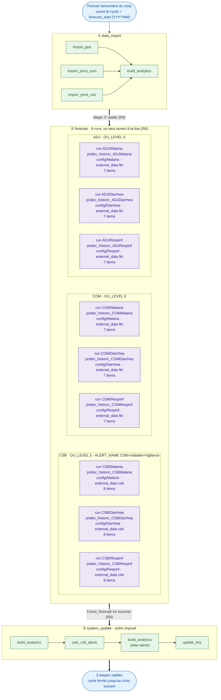
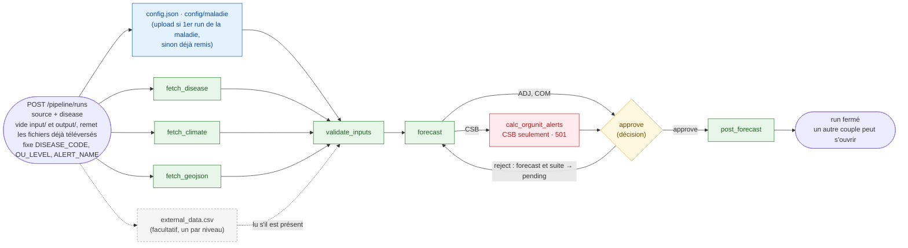
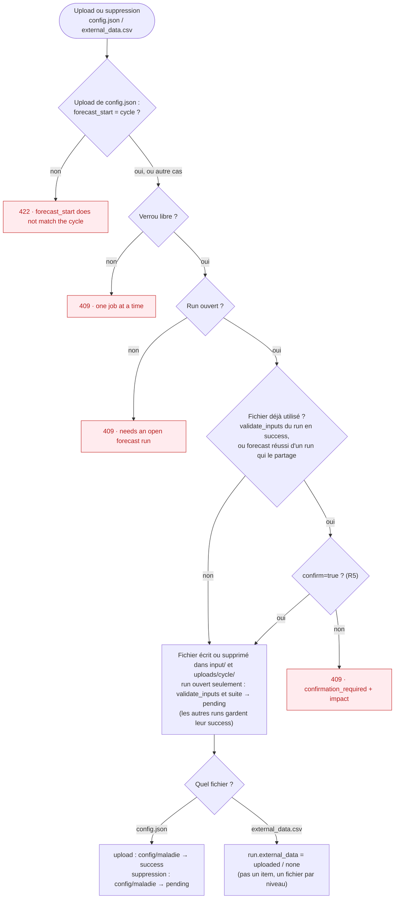
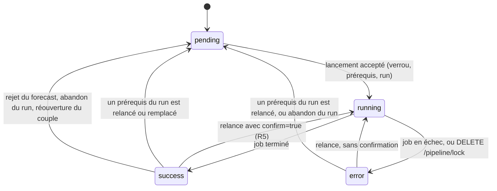
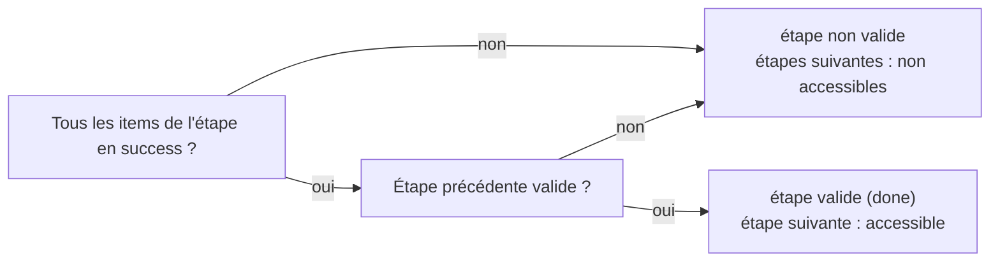
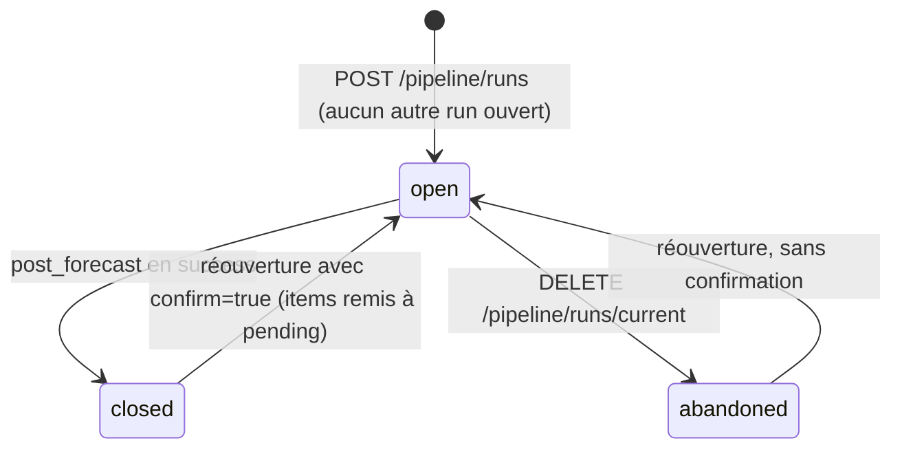

# Contrôle des checkpoints : diagrammes

Ce document rassemble en schémas tout ce qu'etlhub contrôle (conception cible, 2026-10-09).
Les règles sont résumées dans [pipeline-checkpoints-guide.md](pipeline-checkpoints-guide.md),
et la conception complète est dans [pipeline-checkpoints.md](pipeline-checkpoints.md).

| # | Diagramme | Question |
|---|---|---|
| 1 | Le parcours complet | Quelles étapes, quels items, et les 9 runs de forecast en détail ? |
| 2 | Un run de forecast | Comment un couple va-t-il de l'ouverture à `post_forecast` ? |
| 3 | Le contrôle d'un lancement | Que vérifie le serveur avant d'accepter un job ? |
| 4 | Les fichiers d'entrée | Que se passe-t-il quand on téléverse ou supprime `config.json` ou `external_data.csv` ? |
| 5 | La vie d'un item | Comment passe-t-on de `pending` à `success`, et comment en revient-on ? |
| 6 | La vie d'un run et d'un cycle | Quand s'ouvrent-ils et quand se ferment-ils ? |

| Règle | Contenu |
|---|---|
| R1 | Tout item est obligatoire ; `config.json` est un item par maladie ; `external_data.csv` est facultatif, ce n'est pas un item. |
| R2 | Un item exige que ses prérequis soient en `success`. |
| R3 | Un seul job à la fois. Le verrou n'expire jamais (`DELETE /pipeline/lock`). |
| R4 | Une étape n'est valide que si tous ses items sont en `success` et que la précédente est valide. |
| R5 | Défaire ce qui était validé exige `confirm=true`. |
| R6 | Un seul run de forecast ouvert à la fois. |

---

## 1. Le parcours complet d'un cycle

Légende :
- **Vert** : un item, avec un statut en base.
- **Violet** : un run de forecast, résumé ici ; son détail est dans le diagramme 2.
- **Flèche pleine** : prérequis contrôlé par le serveur (R2).
- **Flèche double** : passage d'une étape à la suivante (R4).

Chaque case de run indique les fichiers d'entrée qu'elle utilise ; les uploads eux-mêmes sont détaillés dans le diagramme 2.

> **Quand se font les uploads ?** Il n'y a pas d'étape d'upload : les fichiers se téléversent **pendant les runs**,
> un par un. `config/<maladie>` est téléversé dans le **premier run ouvert de cette maladie** (ADJ, COM ou CSB, peu importe),
> puis remis automatiquement dans `input/` pour ses 2 autres runs. Même principe pour `external_data.csv`, facultatif,
> **par niveau** : téléversé dans le premier run du niveau (fokontany : ADJ ou COM ; CSB), puis remis aux autres runs de ce niveau.
> Soit, sur un cycle, 3 uploads de `config.json` à 3 moments différents, et au plus 2 de `external_data.csv`.

### Les 9 runs

| # | Run | `DISEASE_CODE` | `OU_LEVEL` | `ALERT_NAME` | `config.json` | `external_data.csv` | Items du run |
|---|---|---|---|---|---|---|---|
| 1 | `ADJ/Malaria` | `pridec_historic_ADJMalaria` | 6 (fokontany) | — | `config/Malaria` | fkt | 7 |
| 2 | `ADJ/Diarrhea` | `pridec_historic_ADJDiarrhea` | 6 | — | `config/Diarrhea` | fkt | 7 |
| 3 | `ADJ/Respinf` | `pridec_historic_ADJRespinf` | 6 | — | `config/Respinf` | fkt | 7 |
| 4 | `COM/Malaria` | `pridec_historic_COMMalaria` | 6 | — | `config/Malaria` | fkt | 7 |
| 5 | `COM/Diarrhea` | `pridec_historic_COMDiarrhea` | 6 | — | `config/Diarrhea` | fkt | 7 |
| 6 | `COM/Respinf` | `pridec_historic_COMRespinf` | 6 | — | `config/Respinf` | fkt | 7 |
| 7 | `CSB/Malaria` | `pridec_historic_CSBMalaria` | 5 (CSB) | `CSBMalariaVigilance` | `config/Malaria` | csb | 8 |
| 8 | `CSB/Diarrhea` | `pridec_historic_CSBDiarrhea` | 5 | `CSBDiarrheaVigilance` | `config/Diarrhea` | csb | 8 |
| 9 | `CSB/Respinf` | `pridec_historic_CSBRespinf` | 5 | `CSBRespinfVigilance` | `config/Respinf` | csb | 8 |

Au total, l'étape ② compte 69 items : 3 `config/<maladie>` + 6 × 7 + 3 × 8.
Uploads par cycle : 3 `config.json` (obligatoires) et au plus 2 `external_data.csv` (facultatifs).

---

## 2. Un run de forecast

Le même modèle pour les 9 couples. Les flèches sont des prérequis contrôlés (R2).

Légende : **vert** = item ; **bleu** = upload (item) ; **gris pointillé** = upload facultatif ; **jaune** = décision humaine ;
**rouge** = `calc_orgunit_alerts`, présent dans le parcours mais pas encore implémenté (501).
Ce que chaque job lit et écrit :

| Item | Lit | Écrit |
|---|---|---|
| `config/<maladie>` (upload, une fois par maladie) | — | `input/config.json` (`forecast_start` = cycle, sinon 422), conservé et remis pour les autres runs de la maladie |
| `external_data.csv` (upload facultatif, une fois par niveau) | — | `input/external_data.csv`, conservé et remis pour les autres runs du même niveau |
| `fetch_disease` | `DISEASE_CODE`, `OU_LEVEL`, `PARENT_OU` | `input/disease_data.json` |
| `fetch_climate` | `OU_LEVEL`, `PARENT_OU` | `input/climate_data.json` |
| `fetch_geojson` | `OU_LEVEL`, `PARENT_OU` | `input/orgUnit_poly.geojson` |
| `validate_inputs` | les fichiers ci-dessus | `input/config_valid.json`, `input_valid.json`, `polygon_valid.geojson` |
| `forecast` | les 3 fichiers `*_valid` | `output/forecast.json`, `output/forecast_report.html` |
| `calc_orgunit_alerts` (CSB) | `ALERT_NAME` | 501 : pas implémenté |
| `approve` | `output/forecast_report.html` (lu par l'utilisateur) | décision |
| `post_forecast` | `output/forecast.json` | DHIS2 (PRIDE-C) |

**Abandonner** (`DELETE /pipeline/runs/current`) : le run passe `abandoned`, ses items repassent en `pending`, rien n'est publié.

**Invalidation dans le run** : relancer ou remplacer un item remet en `pending` tout ce qui en dépend
(par exemple, relancer `fetch_climate` remet `validate_inputs`, `forecast`, … en `pending`).

---

## 3. Le contrôle d'un lancement

Ce chemin s'applique à chaque lancement de job : Celery (`/import_*`, `/fetch_*`, `/validate_inputs`, `/build_analytics`,
`/calc_csb_alerts`, `/forecast/`) ou synchrone (`/post_forecast`, `/update_key`). Tout se passe dans une seule transaction
SQLite (`BEGIN IMMEDIATE`) ; un refus n'écrit rien.

**Ouvrir un run** (`POST /pipeline/runs`) suit les mêmes premières vérifications (verrou, cycle), puis :
étape ② accessible, aucun run ouvert (sinon 409), et `confirm=true` si le couple a déjà un run fermé dans le cycle.

---

## 4. Les fichiers d'entrée

`POST` et `DELETE /input/files/{config|external_data}`.

---

## 5. La vie d'un item

L'**étape** n'est pas un état stocké : elle est recalculée à chaque lecture.

Entre étapes, rien n'est remis à zéro : si l'étape ① redevient non valide, les `success` de l'étape ② restent
en base et comptent de nouveau dès que l'étape ① est revalidée.

---

## 6. La vie d'un run et d'un cycle

```mermaid
stateDiagram-v2
    [*] --> Ouvert : premier lancement du mois<br/>cycle = mois courant = forecast_start
    Ouvert --> Ouvert : lancements et runs du mois
    Ouvert --> Inacheve : changement de mois avant la fin<br/>(run ouvert abandonné)
    Inacheve --> [*] : reste dans l'historique ;<br/>le mois suivant a son propre cycle
    Ouvert --> Ferme : les 3 étapes sont valides
    Ferme --> Ferme : tout lancement du même mois → 409 cycle complete
    Ferme --> [*] : premier lancement du mois suivant<br/>ouvre le cycle suivant
```

Limites :
- `calc_orgunit_alerts` répond 501 : les runs CSB, et donc le cycle, ne peuvent pas se terminer tant qu'il n'est pas implémenté.
- Un cycle non terminé à la fin du mois reste inachevé ; un worker tué bloque tout jusqu'à `DELETE /pipeline/lock`.
- **Mode test** (`DRYRUN=true`, `PUT /pipeline/mode`) : mêmes règles et mêmes schémas, mais les checkpoints sont gardés
  dans Redis seulement ; revenir en production les efface (avec `confirm=true` s'il y en a).
- `DELETE /output/reset` et les jobs lancés en ligne de commande échappent à ces contrôles.
