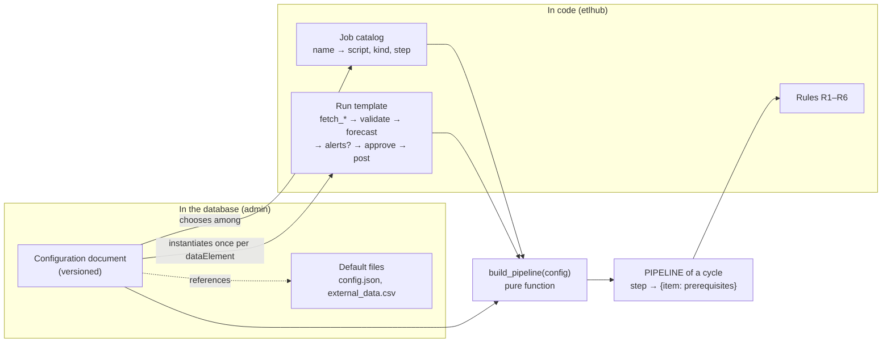
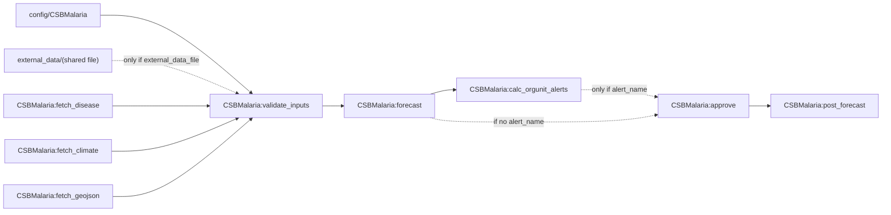
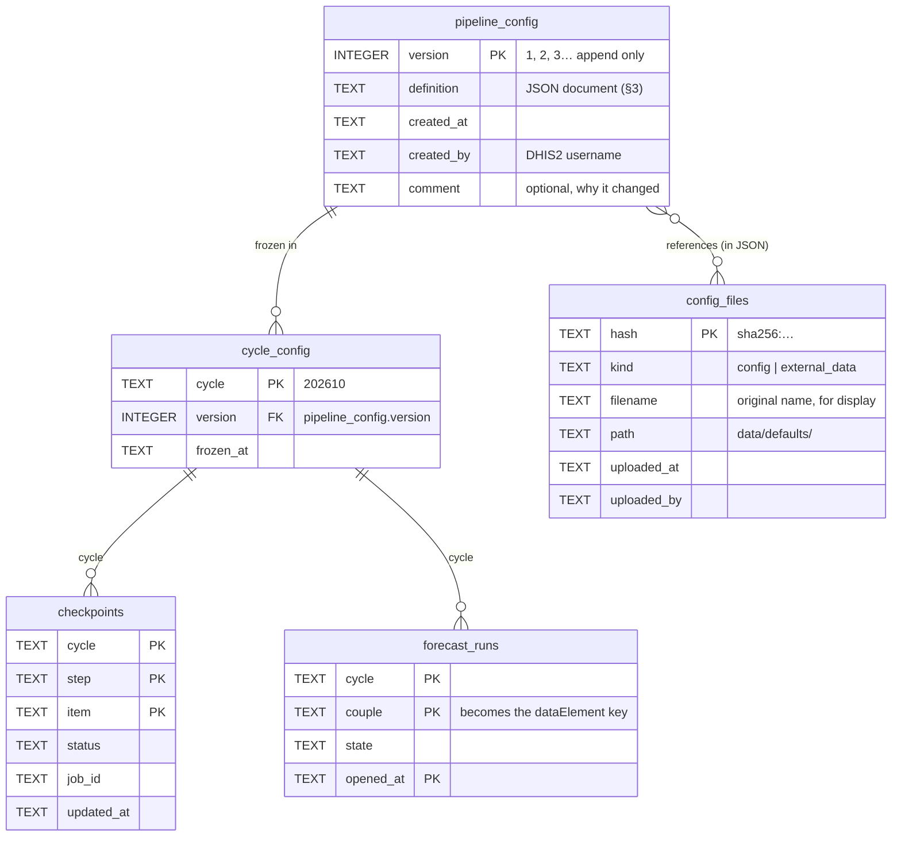
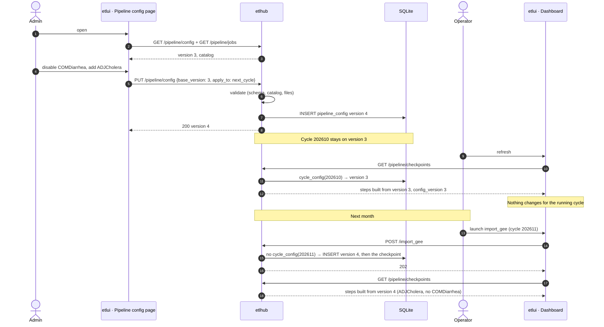
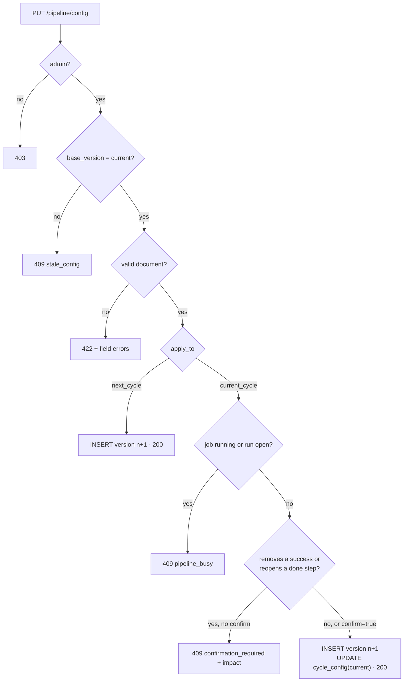
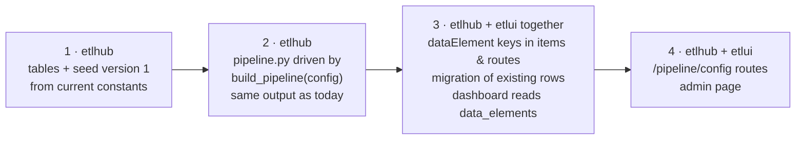

# Pipeline configuration: proposal

> **Status: proposal, not implemented.** Nothing in this document exists in the code yet.
> Open questions are at the end ([§ 10](#10-open-questions)); several choices below are defaults until they are answered.

Today the pipeline is a Python constant (`PIPELINE` in `etlhub/domain/pipeline.py`) and etlui repeats part of it
(`SOURCES`, `DISEASES`, labels in `etlui/src/types/pipeline.ts` and `etlui/src/config/pipeline.ts`).
Changing an item, a disease or a level means changing code on both sides.

This proposal makes the pipeline **configurable by an admin from an etlui page**, stored in **etlhub's database**,
with **etlhub as the single source of truth** and etlui rendering only what etlhub returns.
It implements the "system" configuration already requested in [pipeline-checkpoints-summary.md](pipeline-checkpoints-summary.md#the-system).

| § | Content |
|---|---|
| 1 | What becomes configurable, what stays in code |
| 2 | Principles |
| 3 | The configuration document |
| 4 | Database |
| 5 | API |
| 6 | How etlui and etlhub stay in sync |
| 7 | Changing the configuration: rules |
| 8 | The configuration page (etlui) |
| 9 | Migration plan |
| 10 | Open questions |

---

## 1. What becomes configurable, what stays in code

An item that **runs** something needs a script (`ETL_JOBS` / `SYNC_JOBS` in `etl_use_cases.py`).
An interface cannot create a script: it can only **choose** among the jobs etlhub knows.
So "add or remove items" means: **turn known jobs on or off, and declare the forecast units (`dataElement`s)**.

| Configurable by an admin | Stays in code (and why) |
|---|---|
| ① which `import_*` jobs are required (`import_gee`, `import_pivot_com`, `import_pivot_csb`) | The 3 steps and their order (R4 depends on it) |
| ① whether the `approve_imports` decision is required | What each job does (a script per job) |
| ② the list of `dataElement`s to forecast (add, edit, disable) | The order of jobs inside a run: `fetch_*` → `validate_inputs` → `forecast` → `calc_orgunit_alerts` → `approve` → `post_forecast` |
| ② per `dataElement`: label, `OU_LEVEL`, `ALERT_NAME` (→ `calc_orgunit_alerts` on/off), default `config.json`, default `external_data.csv`, required or optional for the cycle | The special behaviour of decisions (`approve`, `approve_imports`) and of uploads (`config`, `external_data`) |
| Display: labels, grouping in the dashboard | ③ `system_update` (`build_analytics` → `update_key`), fixed by the reference workflow |



## 2. Principles

1. **etlhub is the only source of truth.** etlui keeps no list of steps, items, sources or diseases;
   it renders the definition etlhub returns. Only the 3 step names stay fixed on both sides.
2. **A configuration is versioned and never edited in place.** Saving creates version *n+1*; history and rollback come for free.
3. **A cycle is frozen on one version.** When a cycle opens, it records the version in force; its progress (`done`, R4)
   is always computed against that version. Changing the configuration never rewrites a past cycle.
4. **Same rules, generated graph.** `pipeline.py` stays pure: the module constants become the output of
   `build_pipeline(config)`; R1–R6 are unchanged.
5. **Admin only, audited.** Writes go through `require_admin` (DHIS2 authority `ALL`) and record who saved.
6. **The first version reproduces today's pipeline exactly** (seeded from the current constants), so day one changes nothing.

## 3. The configuration document

One JSON document, validated by a Pydantic schema in etlhub. Example (the Pivot system, as today):

```json
{
  "data_import": {
    "imports": ["import_gee", "import_pivot_com", "import_pivot_csb"],
    "approve_imports": true
  },
  "data_elements": [
    {
      "key": "CSBMalaria",
      "code": "pridec_historic_CSBMalaria",
      "label": "Malaria · Health Centres (CSB)",
      "group": "Malaria",
      "ou_level": 5,
      "alert_name": "CSBMalariaVigilance",
      "config_file": "sha256:3f2a…",
      "external_data_file": "sha256:9bc1…",
      "required": true,
      "enabled": true
    }
  ]
}
```

| Field | Rule |
|---|---|
| `key` | The `<x>` of `pridec_historic_<x>`; unique; `[A-Za-z0-9]+`; never changes once used in a cycle (it names checkpoint items: `CSBMalaria:forecast`). |
| `code` | Derived: `pridec_historic_<key>` (stored for display only). |
| `group` | Display only: groups cards in the dashboard (today, the disease). |
| `ou_level` | Integer, written to `OU_LEVEL` when the run opens. |
| `alert_name` | `null` → no `calc_orgunit_alerts` item in the run. |
| `config_file` | Required. Default `config.json`, an upload in the run can replace it. |
| `external_data_file` | Optional. Several `dataElement`s may point to the same file. `null` → no `external_data` prerequisite. |
| `required` | `false` → the run can be done but step ② is `done` without it. |
| `enabled` | `false` → the `dataElement` disappears from new cycles; kept in the document for history and re-enabling. |
| `imports` | Subset of the import jobs of the catalog. `build_analytics` is always there. |

Files are referenced by **content hash**, so an old version always points to the file it was saved with,
even after the admin uploads a new default.

What `build_pipeline` generates for one `dataElement` (`CSBMalaria`, with alert and external data):



## 4. Database

Same SQLite file as the checkpoints (`logs/etlhub.db`), created by the same `_SCHEMA` mechanism.



- **`pipeline_config`**: one row per saved version. The current configuration is `MAX(version)`.
  A rollback is a save of an old definition as a new version.
- **`cycle_config`**: written in the same transaction as the cycle's first launch (the cycle "opens at the first launch").
  A cycle without a row (cycles from before the migration) uses version 1.
- **`config_files`**: metadata only; the file itself is on disk under `data/defaults/`, named by its hash.
  Never deleted while a version references it.
- `checkpoints`, `pipeline_lock`, `pipeline_cycle` are unchanged. `forecast_runs.couple` keeps its column
  but holds the `dataElement` key (see [§ 9](#9-migration-plan)).

Why one JSON document instead of normalized tables (`data_elements`, `step_items`…): the configuration is
read whole, written whole, versioned whole, and small (a few dozen entries). Normalized tables would need
a version column on every row and joins to rebuild one version, for no query that needs them.

## 5. API

New routes under `/pipeline/config` (etlhub), all JSON.

| Method & path | Who | Does |
|---|---|---|
| `GET /pipeline/config` | logged in | Current version: `{version, definition, created_at, created_by}` |
| `GET /pipeline/config/versions` | logged in | History: version, date, author, comment (no definition) |
| `GET /pipeline/config/{version}` | logged in | One version, for the diff / rollback screen |
| `PUT /pipeline/config` | admin | Body `{base_version, definition, comment, apply_to}`. Validates, saves version *n+1*. |
| `POST /pipeline/config/files` | admin | Upload a default `config.json` / `external_data.csv`; returns its `hash`. Same validation as the run uploads. |
| `GET /pipeline/config/files/{hash}` | logged in | Download a default file (preview in the page) |
| `GET /pipeline/jobs` | logged in | The job catalog: `name`, `step`, `kind` (`celery`, `sync`, `decision`, `upload`), `available` (`false` while no script, e.g. `calc_orgunit_alerts`) |

Answers of `PUT /pipeline/config`:

| Code | When |
|---|---|
| 200 | Saved; returns the new version. |
| 422 | Invalid document: unknown job, duplicate `key`, unknown file hash, a used `key` renamed, `imports` empty… |
| 409 `stale_config` | `base_version` is not the current version (another admin saved in between). Nothing written. |
| 409 `confirmation_required` | `apply_to = current_cycle` and the change affects work already done (R5). `impact` lists it. Resend with `confirm=true`. |
| 409 `pipeline_busy` | `apply_to = current_cycle` while a job runs or a forecast run is open. |

Changed existing routes (contract shared with etlui, changed on both sides at once):

| Route | Change |
|---|---|
| `GET /pipeline/checkpoints` | Adds `config_version` (the cycle's frozen version) and `data_elements` (`key`, `label`, `group`, `required`, `has_alerts`, `has_external_data`). |
| `POST /pipeline/runs` | Body takes the `dataElement` `key` instead of `couple`. |
| `GET /pipeline/runs/{source}/{disease}/report` | Becomes `GET /pipeline/runs/{key}/report`. |
| Items | `CSB/Malaria:forecast` → `CSBMalaria:forecast`; `config/Malaria` → `config/CSBMalaria`; `external_data/fkt` → `external_data/<hash prefix or file name>` (see question Q4). |

## 6. How etlui and etlhub stay in sync

"Synchronous" here means: **etlui never shows a pipeline different from the one etlhub enforces.**



Rules that keep both sides aligned:
1. **The dashboard renders from `GET /pipeline/checkpoints` only**: steps, items, `data_elements`, labels.
   The constants `SOURCES`, `DISEASES`, `CONFIG_FILES`, `LEVEL_NAMES` are deleted from etlui.
   Card labels and icons stay in etlui per **job name** (a closed list, the catalog), with the existing fallback for an unknown job.
2. **Every launch is checked by etlhub against the cycle's frozen version.** A stale screen can show a button,
   it cannot launch something the version does not have (the usual 409, nothing written).
3. **`config_version` tells etlui when its view is stale**: the dashboard already re-reads the checkpoints after each action
   and while a job runs; if `config_version` changed, it rebuilds its layout (no extra endpoint, no WebSocket).
4. **Two admins editing at once**: optimistic concurrency with `base_version` → 409 `stale_config`, the page reloads and shows the newer version.

## 7. Changing the configuration: rules

| | Rule |
|---|---|
| C1 | A save never changes a past cycle: its `cycle_config` row is never updated. |
| C2 | By default (`apply_to = next_cycle`) a new version applies to the next cycle that opens. |
| C3 | `apply_to = current_cycle` re-freezes the current cycle on the new version. Refused while a job runs or a run is open (`pipeline_busy`). |
| C4 | Applying to the current cycle needs `confirm=true` (R5) when it removes an item already in `success`, or adds an item to a step already `done` (the step would become not done). `impact` lists both. |
| C5 | Removing an item never deletes its checkpoint rows: they are kept and ignored, and count again if the item comes back. |
| C6 | A `key` that appears in any checkpoint cannot be renamed or deleted, only disabled. |
| C7 | A job whose script does not exist (`available: false`) can be selected but the page warns that the cycle will not complete. |
| C8 | Test mode: see question Q6. |



## 8. The configuration page (etlui)

New route `/admin/pipeline`, next to the existing `/admin/config`, visible to admins only (the API refuses others anyway).

```
┌─ Pipeline configuration ─────────────────────────── version 3 · by admin · 2026-10-14 ─┐
│                                                                                         │
│  ① Data import                                                                          │
│     [x] Import GEE      [x] Import Pivot COM      [x] Import Pivot CSB                  │
│     [x] Imports approval required                 Build Analytics (always)              │
│                                                                                         │
│  ② Forecasts                                                  [ + Add a dataElement ]   │
│  ┌──────────────┬──────────────────────────┬──────┬─────────────────┬──────┬────────┐  │
│  │ key          │ label                    │ OU   │ alert           │ req. │        │  │
│  ├──────────────┼──────────────────────────┼──────┼─────────────────┼──────┼────────┤  │
│  │ ADJMalaria   │ Malaria · Adjusted       │ 6    │ —               │ yes  │ edit ⏻ │  │
│  │ CSBMalaria   │ Malaria · Health Centres │ 5    │ CSBMalariaVig…  │ yes  │ edit ⏻ │  │
│  │ …            │                          │      │                 │      │        │  │
│  └──────────────┴──────────────────────────┴──────┴─────────────────┴──────┴────────┘  │
│                                                                                         │
│  ③ System update        Build Analytics → Update Key (fixed)                            │
│                                                                                         │
│  Apply to:  (•) next cycle   ( ) current cycle 202610                                   │
│  Comment:   [ removed COM Diarrhea, see ticket #12                    ]                 │
│                                                       [ History ]  [ Discard ] [ Save ] │
└─────────────────────────────────────────────────────────────────────────────────────────┘

Edit dataElement (dialog)
  key           [CSBMalaria]     (locked once used)
  label         [Malaria · Health Centres]
  group         [Malaria]
  OU level      [5]
  alert name    [CSBMalariaVigilance]   (empty = no alerts step)
  config.json   config_malaria.json ✓   [Replace] [Preview]
  external data external_data_csb.csv   [Replace] [Remove]
  [x] required for the cycle
```

- Reuses the existing components: `ConfirmDialog` / `ImpactDialog` for C4, `FileDropzone` + `ConfigPreview` / `CsvPreview` for default files.
- **History**: list of versions, a side-by-side diff of two definitions, "Restore" (= save the old definition as a new version).
- A Pinia store `pipelineConfig` holds the loaded version and the draft; leaving the page with an unsaved draft asks first.

Dashboard changes: step ② is built from `data_elements` grouped by `group` (today's disease cards become groups),
instead of the fixed `SOURCES × DISEASES` grid.

## 9. Migration plan

Each phase can ship alone; behaviour only changes in phase 4.



1. **Tables and seed.** Create `pipeline_config`, `cycle_config`, `config_files`; insert version 1 built from today's
   `PIPELINE`, `OU_LEVEL`, `run_context` and the files in `forecast_assets/`. Check: `build_pipeline(version 1) == PIPELINE` (today's).
2. **Pure domain on a config.** Every function of `pipeline.py` takes the cycle's built pipeline instead of module constants.
   The existing tests must pass unchanged.
3. **Rename items to `dataElement` keys** (contract change, etlhub and etlui in the same change):
   one SQL migration `CSB/Malaria` → `CSBMalaria` in `checkpoints.item` and `forecast_runs.couple`,
   new run and report routes, etlui reads `data_elements`. This is the riskiest phase (history + contract).
4. **Configuration routes and page.**

Not verified while writing this: which etlhub and etlui tests assume a fixed number of items (71) or the `couple` format;
how per-disease `config.json` uploads already stored under `data/uploads/` map to per-`dataElement` uploads.

## 10. Open questions

| # | Question | Default if not answered |
|---|---|---|
| Q1 | Should the admin be able to add items **inside** a step (e.g. a new import job), or only turn on/off the jobs that have a script? A new job always needs code. | On/off among known jobs only. |
| Q2 | `config.json`: today one per **disease**, shared by 3 runs. The summary says one per **run** (`dataElement`). Which one? | One per `dataElement`, the admin points several to the same default file if needed. |
| Q3 | Should a configuration change apply to the **current cycle** at all, or only to the next one? | Next cycle by default; current cycle possible with the C3/C4 rules. |
| Q4 | `external_data.csv`: shared files (today one per level, fkt/csb). Should the item stay "one per shared file" (uploaded once, used by several runs) or become one per run? | One per shared file, named by the admin (e.g. `external_data/fkt`). |
| Q5 | Existing history: migrate old rows to the new item names (`CSBMalaria`), or leave old cycles readable only through a legacy path? | Migrate (one SQL migration, phase 3). |
| Q6 | Test mode: should the configuration be shared between test and production, or should test mode have its own draft configuration (to try a configuration before using it)? | Shared; only the cycle data follows the mode, as today. |
| Q7 | Who is an admin for this page: DHIS2 authority `ALL` (same as `require_admin`), or a dedicated DHIS2 role? | `ALL`. |
| Q8 | `approve_imports` thresholds (COM < 100, CSB < 1000): should they be configurable and shown to the user, or stay a human judgement outside the app? They are not in the code today. | Not configurable (out of scope). |
| Q9 | Should a step ② be `done` when every **required** `dataElement` is published, ignoring the optional ones (`required: false`)? | Yes. |
| Q10 | One etlhub = one DHIS2 system: is one configuration per etlhub enough, or must one etlhub hold several systems? | One per etlhub. |
